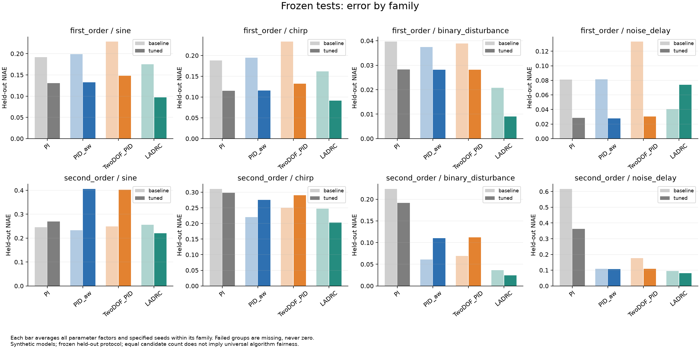
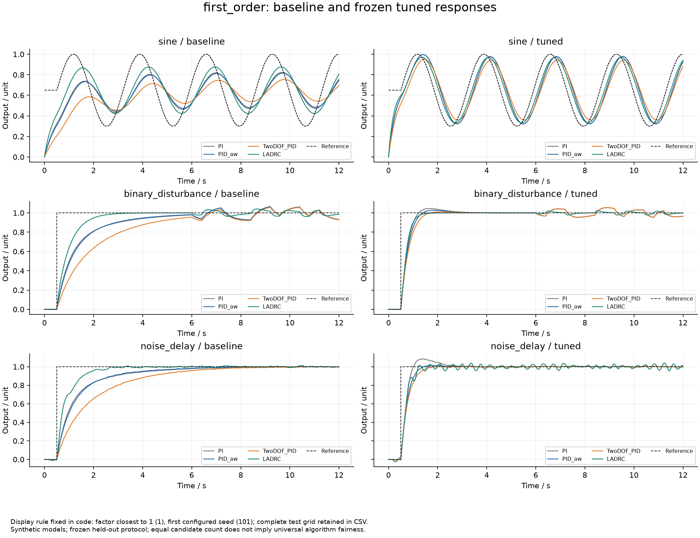

# ControlStressLab

[](https://github.com/yuz237177-cyber/ControlStressLab/actions/workflows/tests.yml)
[](https://github.com/yuz237177-cyber/ControlStressLab/releases/tag/v0.3.0)

**面向单输入单输出系统的控制器压力测试、参数整定与性能评估工具。**

Reproducible SISO controller stress testing, budgeted tuning, and frozen held-out evaluation.

配置被控对象与信号，选择控制方案，在相同条件下比较误差、控制动作、饱和与恢复行为；结果可以追溯到配置、轨迹、随机种子和源码指纹。项目以动力学类型组织，电机是可选应用案例。

> **v0.3.0 的全部公开结果来自合成仿真，尚未进行硬件验证。** 可复现不等于模型代表真实设备，也不构成稳定性证明。

## v0.3：调参之后真的更好吗？

新增一阶惯性与二阶振荡对象的预算化整定：每组32个候选，只在3个训练场景上选择；**冻结参数后**，再测试未参与选择的信号、对象参数和噪声种子。默认768次训练 + 384次冻结测试。



本轮一阶对象的4种方案总体误差均下降，但二阶抗饱和PID的族等权NIAE从0.1558上升到0.2242，其动作变化率则下降。一阶LADRC总体误差下降，噪声场景误差和动作变化却增加。**训练改善不保证测试改善，误差与执行代价需要一起看。**

这些数值只对应公开协议与有限搜索范围，不是算法普遍排名；相同候选数也不保证不同维度的算法严格公平。

[实验设计](docs/BENCHMARK_DESIGN.md) · [实际结果](docs/BENCHMARK_RESULTS.md) · [完整报告与图片](reports/benchmark-v0.3.0-2026-10-24/report.html) · [数据和源码ZIP](reports/benchmark-v0.3.0-2026-10-24.zip)

GitHub不直接运行离线HTML；下载仓库或ZIP，在本机打开 `report.html`。

## 快速开始

需要Python 3.10+。核心仿真和报告无第三方运行依赖，绘图与SciPy对照为可选依赖。

```sh
python -m pip install -e ".[charts]"
controlstresslab-benchmark --config configs/benchmark-v0.3.json --output outputs/my-benchmark --plots
```

打开 `outputs/my-benchmark/report.html`。较小实验可使用 `configs/benchmark-ci.json`。不需要图片时去掉 `--plots`，只安装 `python -m pip install -e .`。

安装wheel后也可直接运行默认协议，无须配置文件：

```sh
controlstresslab-benchmark --output my-benchmark
```

输出目录必须不存在，重新运行请换新目录。出现失败会保留诊断和已有记录；没有可行训练候选时明确终止，不悄悄替换控制器。失败或中断返回非零退出码。

## 测试工作流

1. **配置对象与输入**：选择模型、参考、扰动、噪声、测量延迟与执行限幅。
2. **选择控制方案**：使用内置控制器，或通过Python接口接入。
3. **固定比较规则**：运行固定参数覆盖实验，或预先声明搜索范围、预算和动作约束的训练方案。
4. **评估与解释**：分别查看IAE/RMSE、输入变化量、饱和比例和恢复状态；持续变化参考的常数恢复时间标为不适用。
5. **保存证据**：离线HTML、逐次CSV/JSON、配对输入/噪声、源码指纹、PNG/SVG和校验清单。

## 对象、算法与信号

| 动力学类型 | 当前代表对象 | 输入/输出单位 |
|---|---|---|
| 一阶惯性 | `FirstOrder` | 教学模型unit，可设增益与时间常数 |
| 二阶振荡 | `MassSpringDamper` | 力N / 位移m；质量、阻尼、刚度 |
| 机电耦合应用 | 约化、含电感直流电机 | 电压V / 角速度rad/s |

- 控制方案：PI、条件积分抗饱和PID、二自由度PID、一/二阶线性ADRC。ADRC只使用测量和实际输入，不读取真实速度、外扰或其他隐藏状态。
- 参考：阶跃、斜坡、正弦、三角、扫频、多次阶跃。
- 扰动：阶跃、脉冲、正弦、方波、扫频、固定种子的独立二值块；另有噪声、测量延迟与组合条件。
- 信号预采样并零阶保持；当前二值块不是最大长度LFSR序列。
- Python接口可扩展；当前没有通用非线性模型库、执行输入延迟、实测闭环接入或多变量评测。

### 固定参数覆盖

```sh
controlstresslab-coverage --models first_order,mass_spring_damper --scenarios reference_sine,disturbance_prbs --output outputs/coverage-small --plots
controlstresslab-coverage --output outputs/full-coverage --plots
```

完整覆盖为4对象×4控制方案×14场景，共224次及12组PNG/SVG。参数按对象固定，没有逐场景调参。



### 参数失配与压力扫描

v0.3测试改变一阶时间常数和二阶质量，控制器保持名义参数；同时比较新频率、二值扰动、噪声与延迟。配置和选择日志公开于报告。

电机案例仍保留：惯量/摩擦7×7网格共196次，负载/测量延迟网格共286次，作为应用层示例运行：

```sh
controlstresslab-uncertainty --output outputs/motor-uncertainty --plots
controlstresslab-stress-grid --output outputs/motor-stress-grid --plots
controlstresslab --output outputs/legacy-motor-demo
```

## 结果核验

```sh
python -m unittest discover -s tests -v
python scripts/check_benchmark_evidence.py --suite outputs/my-benchmark --output outputs/my-benchmark-audit.json
python -m pip install ".[reference]"
python scripts/check_coverage_reference.py --suite outputs/my-benchmark --output outputs/my-benchmark-scipy.json
```

产物审计独立检查训练选择、冻结指纹、配对输入、逐次配置及CSV指标；SciPy脚本不导入产品模块，以独立状态空间矩阵复算对象响应与LADRC请求。新实验保存432条原始轨迹，全部通过两类检查。另保留54配置的独立闭环/开环实现对照。

对象输入回放不等于新的完整独立非线性闭环实验，同一开发者的第二份实现也不等于第三方审计。详见[当前校验状态](docs/VERIFICATION_STATUS.md)。

只有 `status.json` 中 `artifacts_complete=true` 且校验清单通过，才表示产物完整；它不表示全部运行成功。失败指标为null，不作零误差。变化量不是能耗，观察窗恢复不是无限时域稳定性。场景和参数网格不作为IID样本，不换算为现实可靠性概率。

## 保存和复现

[全部历史成果](reports/README.md)保留本轮8组PNG/SVG、384条测试与48条训练CSV，以及此前各轮所有报告和图片。

```sh
python scripts/archive_results.py --source outputs/my-benchmark --destination reports/my-benchmark
```

归档复制完整产物和匹配源码，生成逐文件校验后的ZIP。目标已存在时拒绝覆盖。

| 文档 | 内容 |
|---|---|
| [v0.3设计](docs/BENCHMARK_DESIGN.md) / [结果](docs/BENCHMARK_RESULTS.md) | 搜索、预算、约束和训练/测试隔离 |
| [覆盖设计](docs/COVERAGE_EXPANSION_DESIGN.md) / [结果](docs/COVERAGE_EXPANSION_RESULTS.md) | 模型、波形和控制方案 |
| [扩展接口](docs/EXTENDING.md) | 自定义对象、控制器与信号 |
| [实验协议](docs/EXPERIMENT_PROTOCOL.md) | 时序、指标、窗口及失败 |
| [独立对照](docs/REFERENCE_COMPARISON_DESIGN.md) | 数值路径、范围与容差 |
| [验证计划](docs/VALIDATION_PLAN.md) / [数据说明](data/README.md) | 合成与实测证据边界 |
| [路线](docs/ROADMAP.md) / [变更](CHANGELOG.md) | 当前与后续工作 |

欢迎带配置、环境和复现步骤的问题反馈。引入对象请说明单位、假设及参数来源。MIT License.
