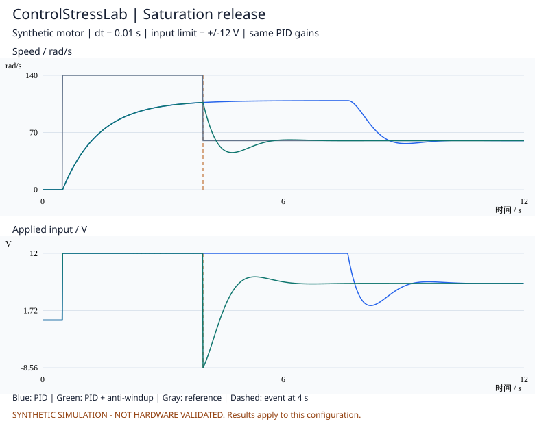
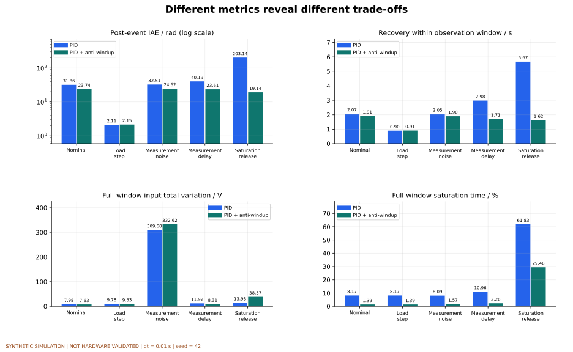

# ControlStressLab

[](https://github.com/yuz237177-cyber/ControlStressLab/actions/workflows/tests.yml)

**可复现的控制器压力测试与性能评估工具。**

Connect a SISO controller, run explicit stress scenarios, and inspect performance trade-offs.

在相同的负载、测量噪声、延迟与执行限幅下比较控制器，并追溯每次运行的配置、轨迹和失败原因。

> **当前为 v0.1.2 原型，全部示例均为合成仿真，尚未进行硬件验证。**
> 模型参数、负载幅值、噪声与延迟是公开的教学假设。可复现不等于真实；完成仿真不等于稳定性证明。

## 看一个结果



这个案例先给出无法达到的 140 rad/s 参考值，在 4 s 时回落到 60 rad/s。两种控制器使用相同增益，
区别仅为是否启用条件积分抗饱和。棕色虚线标出回落时刻；恢复要求此后最终连续进入 ±1.2 rad/s 带内至少 0.5 s。

| 场景 | 普通 PID：事件后 IAE / rad | 抗饱和 PID：事件后 IAE / rad | 普通 / 抗饱和恢复时间 / s |
|---|---:|---:|---:|
| 饱和后参考回落 | 203.139 | 19.144 | 5.67 / 1.62 |
| 负载阶跃 | 2.111 | 2.152 | 0.90 / 0.91 |

抗饱和在该参考回落案例中有明显收益；负载阶跃案例的事件后误差则略大。这些结果只对应当前模型、参数与观察窗口。
完整配置与未舍入指标见 [示例说明](docs/examples/README.md)。

更多图表见 [九张图表与说明](docs/examples/gallery/README.md)，或在本机打开 `docs/examples/gallery/index.html`。
包括五场景的输出/误差/实际输入、四项指标总览、噪声与延迟细节、事件后累计误差，以及请求/实际电压。



## 快速运行

需要 Python 3.10 或更新版本，无第三方运行依赖。在仓库根目录执行：

```sh
python run_demo.py --output outputs/demo
```

打开 `outputs/demo/report.html`。报告包含曲线预览、指标、CSV 原始轨迹、逐次实验配置与文件校验值。
输出目录必须不存在，避免覆盖已有实验。再次运行请选择新的目录。

```sh
python run_demo.py --seeds 11,22,33 --output outputs/repeated
python -m unittest discover -s tests -v
```

默认在记录一次失败后停止套件并产出报告。如需继续其余运行，使用 `--continue-on-failure`。
存在失败运行时命令行返回非零退出码。异常中止会保留 `status.json`，不删除已有记录。
以 `status.json` 为权威批次状态；仅 `artifacts_complete=true` 且输出校验值通过才表示产物集写出完整，
它不表示所有运行均成功。状态与时间字段见 [实验协议](docs/EXPERIMENT_PROTOCOL.md)。

如果需要安装命令行入口：

```sh
python -m pip install -e .
controlstresslab --output outputs/installed-demo
```

重建额外图表需要可选的 Matplotlib，不影响核心仿真与离线报告的零第三方依赖：

```sh
python -m pip install ".[charts]"
python scripts/build_chart_gallery.py
```

此命令更新 `docs/examples/gallery/` 的 PNG、SVG、说明和配置快照。可用 `--output outputs/my-gallery` 指定其他位置。

## 第一版做什么

- 单输入单输出、固定采样周期的闭环测试接口。
- 简化直流电机模型；精确的一阶保持输入状态更新。
- 普通 PID 与条件积分抗饱和 PID，默认同一组增益。
- 正常工况、负载阶跃、测量噪声、测量延迟、饱和后参考值回落，共五种场景。
- 成对使用相同的噪声序列；每次实验重置模型和控制器。
- 输出跟踪误差、控制变化量、饱和比例、观察窗口内的恢复时间。
- 分别记录事件锚点前后的 IAE、RMSE 和时长，避免把起步误差当成抗负载扰动表现。
- 标记越界/数值失败，失败运行不参与完整时长指标比较。
- 区分接口错误和数值失败，保留阶段、异常类型及诊断；检查测量有限性。
- 报告展示真实输出、控制器可见测量、请求输入和实际输入。

命令行示例目前只运行内置电机测试套件。自定义对象和控制器通过 Python 接口接入，见 [扩展说明](docs/EXTENDING.md)。

## 结果如何理解

- 指标基于仿真真实输出计算；控制器只能使用测量值。
- 输出限制为双向 ±12 V 的教学假设，不代表现有小车的硬件配置。
- 140 rad/s 的饱和场景有意超过示例电机可达到的稳态转速，用于观察回落后的恢复。
- 不给控制器打总分，不预设某种控制器一定胜出。
- 输入变化量不是能耗；恢复时间也不是无限时域稳定性结论。
- 当前是一种对象、一组控制参数的演示套件，不是通用算法排行榜。
- CSV 终点或未发出动作的状态行输入为空；失败时可能动作已发出但推进未完成，按 `action_taken`、`transition_completed` 判读。
- 配置最多允许 200,000 个推进区间，超过时先拒绝，避免直接分配过大轨迹。

## 项目文档

| 文档 | 内容 |
|---|---|
| [整体框架](docs/PROJECT_FRAMEWORK.md) | 定位、用户、边界、六模块架构 |
| [数学模型与时序](docs/MODEL_AND_TIMING.md) | 方程、参数、单位、采样顺序、延迟定义 |
| [可信度与验证](docs/VALIDATION_PLAN.md) | 工具正确性、实测模型验证、实物闭环证据 |
| [当前校验状态](docs/VERIFICATION_STATUS.md) | 已运行的检查、环境和证据限制 |
| [实验协议](docs/EXPERIMENT_PROTOCOL.md) | 对照、调参、随机性、指标、失败记录 |
| [扩展说明](docs/EXTENDING.md) | 被控对象、控制器、场景接入 |
| [数据说明](data/README.md) | 数据来源、实测数据要求与证据状态 |
| [版本路线](docs/ROADMAP.md) | 已实现和待完成工作 |
| [版本变更](CHANGELOG.md) | 版本功能和输出格式变化 |

## Contributing

欢迎补充能独立核验的案例、边界测试和问题报告。提交结果时附环境、完整配置、随机种子与复现步骤。
引入新模型时说明单位、假设及参数来源；不要把合成参数标记成实测参数。

## References

- [python-control](https://github.com/python-control/python-control)：可用于后续独立对照，本原型目前没有依赖或调用它。
- [NASA 模型与仿真验证资料](https://ntrs.nasa.gov/api/citations/20160001729/downloads/20160001729.pdf)：区分实现验证与现实有效性验证。
- [独立数据验证模型](https://www.mathworks.com/help/ident/ug/specifying-estimation-and-validation-data.html)。
- [残差分析](https://www.mathworks.com/help/ident/ug/examine-model-residuals.html)。

License: [MIT](LICENSE)。第三方模型、数据和文献各自的许可仍适用。
