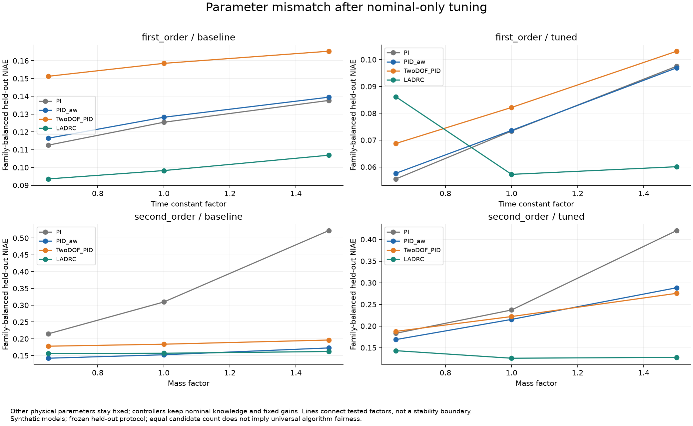

# v0.3 参数整定与冻结测试结果

日期2026-10-24。先固定[设计](BENCHMARK_DESIGN.md)与[配置](../configs/benchmark-v0.3.json)，随后执行768次训练和384次冻结测试，全部完成，无执行/指标失败。每组32个候选，每候选3场景；8组选择均存在可行候选。

## 整体结果

NIAE与控制动作变化率均先在测试族内等权，再对4族等权。NIAE越小表示窗口误差越小；动作变化率单位1/s，不代表能耗。每行是同一算法在相同24个条件下的比较，不是算法普遍排名。

| 对象 | 方案 | NIAE 基线 → 整定 | 动作变化率 基线 → 整定 |
|---|---|---:|---:|
| 一阶 | PI | 0.125218 → 0.075482 | 0.4113 → 0.8859 |
| 一阶 | 抗饱和PID | 0.128059 → 0.076069 | 1.0231 → 1.0032 |
| 一阶 | 二自由度PID | 0.158367 → 0.084687 | 0.9877 → 0.9855 |
| 一阶 | LADRC | 0.099580 → 0.067819 | 0.4173 → 1.6320 |
| 二阶 | PI | 0.348869 → 0.280368 | 0.7274 → 0.5649 |
| 二阶 | 抗饱和PID | 0.155809 → 0.224219 | 6.0233 → 3.4736 |
| 二阶 | 二自由度PID | 0.186068 → 0.228439 | 6.0000 → 3.4556 |
| 二阶 | LADRC | 0.158388 → 0.132150 | 1.3471 → 2.7590 |

二阶抗饱和PID的正弦族NIAE从0.233470升至0.405481；二自由度PID从0.248477升至0.402542。它们按训练规则入选，但阶跃/斜坡/扰动训练目标不能保证持续跟踪的泛化。保留这些结果，没有利用测试反馈重新选择候选。

一阶LADRC的族等权误差下降，但噪声与测量延迟族NIAE从0.040676升至0.073956，动作变化率从0.891896升至5.445252/s。训练没有噪声，训练约束只对训练场景成立。这支持后续改进训练覆盖和目标设计，不能把当前测试改成训练后仍称为未见测试。

## 选择和证据

| 对象 | PI | 抗饱和PID | 二自由度PID | LADRC |
|---|---:|---:|---:|---:|
| 一阶：入选候选序号 | 11 | 11 | 11 | 26 |
| 一阶：可行候选数/32 | 32 | 32 | 32 | 32 |
| 二阶：入选候选序号 | 8 | 19 | 19 | 28 |
| 二阶：可行候选数/32 | 21 | 30 | 30 | 32 |

候选0为上轮公开基线。参数只由训练决定；`events.jsonl`记录训练开始、选择冻结、测试开始、完成四阶段，选择文件SHA与manifest及事件一致。全部候选参数、逐场景指标及轨迹指纹公开；基线和入选训练轨迹直接保留，没有额外重跑或消耗候选预算。

- [完整报告](../reports/benchmark-v0.3.0-2026-10-24/report.html)，下载仓库后本机打开。
- [冻结选择](../reports/benchmark-v0.3.0-2026-10-24/selections.json)、[逐次指标](../reports/benchmark-v0.3.0-2026-10-24/summary.csv)、[未舍入汇总](../reports/benchmark-v0.3.0-2026-10-24/summary.json)。
- [完整ZIP](../reports/benchmark-v0.3.0-2026-10-24.zip)：384条测试CSV、48条训练CSV、全部配对输入、候选日志、8组PNG/SVG、源码快照和校验清单。
- [独立产物与指标审计](../reports/benchmark-evidence-v0.3.0-2026-10-24.json)。
- [独立SciPy核对](../reports/benchmark-reference-v0.3.0-2026-10-24.json)。

独立审计覆盖432条保存轨迹的CSV指标与训练选择；SciPy复算432条对象轨迹、108条LADRC请求，采用预定`1e-8 + 1e-9*|参考值|`逐点容差。误差、脚本指纹和环境见JSON。SciPy环境为独立Python3.9.13/SciPy1.9.1，产品为Python3.12.14。

最大对象输出绝对差为1.266e-14，最大LADRC请求绝对差为8.438e-14；独立CSV指标复算最大差3.553e-15。
本机131项测试通过；0.3.0 wheel独立安装后，在源码目录外完成两对象×四方案的160次小实验。
完整归档保留971个文件（另有归档清单），ZIP逐项核对通过。统一图表纵轴后的最终运行与首轮选择、候选日志及数值汇总一致。

## 图表和限制

8组图各含PNG/SVG：训练候选分数、训练误差/动作取舍、4测试族误差、测试误差/动作散点、一阶响应、二阶响应、噪声下实际控制动作、对象参数敏感性。响应展示规则固定为参数因子最接近1、配置中的第一个种子；其余条件全部保存。成对响应采用相同纵轴尺度。

预算相等不等于搜索维度、先验、带宽或成本相等；随机搜索不保证最优。有限训练和搜索范围不能支撑算法普遍优劣。没有控制周期敏感性完整扫描、实测辨识或设备闭环；对象回放和观察器矩阵不等于完整独立非线性闭环验证。参数因子/场景不是IID重复，不提供现实成功概率。
