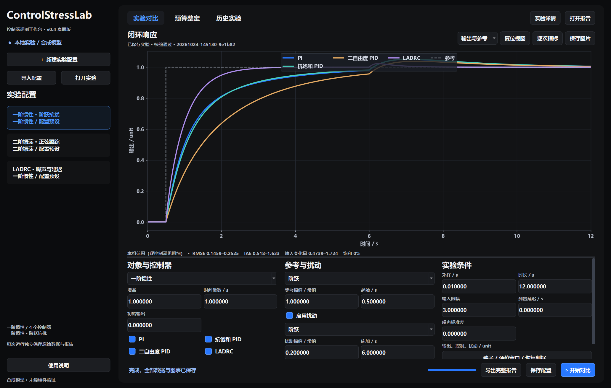
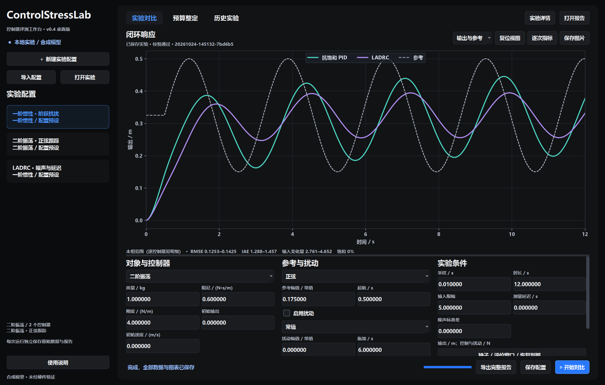
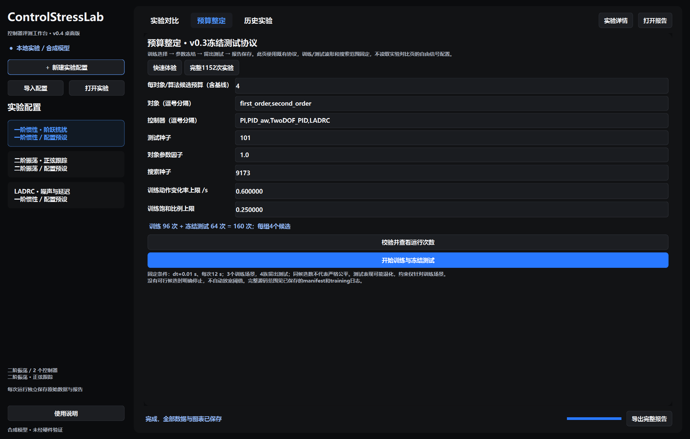

# 桌面实验工作台使用说明

当前为 **v0.4.0桌面版（Python环境）**，支持Windows独立窗口。与命令行使用同一配置、仿真循环与指标计算；所有结果均为合成模型。[版本下载](https://github.com/yuz237177-cyber/ControlStressLab/releases/tag/v0.4.0)。

## 启动

在当前这台电脑双击仓库根目录的 **Start-ControlStressLab.cmd**；桌面依赖已安装在项目本地。也可以运行：

```sh
python run_gui.py
```

在其他电脑需要先安装Python 3.10+，在仓库目录执行：

```sh
python -m pip install -e ".[gui]"
python run_gui.py
```

安装后亦可使用 `controlstresslab-gui --workspace 你的数据目录`。源码启动器默认将数据保存在仓库的 `outputs/gui`，可通过 `python run_gui.py --workspace 你的数据目录` 更改。若仓库放在只读位置，请指定可写目录。

当前启动器依赖Python环境，不是免安装便携EXE；便携包与干净环境验收将另做一轮。

## 完成一次实验

1. 左侧选择“一阶惯性·阶跃抗扰”，或选择二阶与噪声/延迟预设。
2. 下方三栏配置对象、控制方案、参考/扰动和实验条件。高级按钮可修改控制器参数、频率/偏置、随机种子与评价窗口。
3. 点击“开始对比”。运行期间配置暂时锁定，进度显示已完成次数。计算和默认图表生成在独立进程中进行。
4. 使用曲线下拉框查看输出、误差、实际输入或信号预览；点击图例线段可隐藏曲线，滚轮缩放、左键拖动平移，“复位视图”恢复完整范围。
5. “逐次指标”显示各方案的原始指标、执行状态和终止原因；“实验详情”显示实际配置、单位与来源。“打开报告”查看离线HTML。
6. 默认图和原始数据自动保存。“保存图片”另存当前视图，“导出完整报告”在后台打包并逐项校验ZIP。





参数区可以滚动，上下区域分隔线可拖动；主工作区以曲线为主。界面使用系统窗口边框，支持最小化、最大化和关闭。

## 配置与数值含义

- 一阶：`tau*y'=-y+gain*u+d`，使用教学单位unit；二阶：`m*x''+c*x'+k*x=u+d`，输出m，输入/扰动N。
- 各方案共享同一参考、扰动、噪声数组、限幅、采样与评价窗口；控制器不读取真实外扰或隐藏状态。
- “常值”时，主界面的“幅值/常值”输入设置整个窗口的常值；其他波形的偏置另在高级面板设置。起始、延迟、评价窗口等时间必须对齐采样周期，运行前统一校验，不默默修正。
- 当前桌面数值表单使用6位小数、最大绝对值1000000，另有各条件正值/非负限制；导入时若可见值无法精确表示会明确拒绝，不静默截断。更高精度或超范围配置可使用CLI。
- 持续变化参考/扰动默认使用tracking_only，常数恢复时间不适用；失败指标为null，界面显示“—”，不会填0。
- LADRC观察器带宽乘采样周期须不超过0.2。PI固定无微分与无抗饱和；另两种PID保留抗饱和定义。
- 修改草稿后，已保存响应继续显示原实验，旁边标明“草稿已修改”。“信号预览”只画参考与扰动，不能当作闭环响应。
- 长轨迹只在界面显示时降采样：预览约5000点、结果约8000点；完整CSV与指标不降采样。
- 输入总变化量不是能耗；恢复时间不是稳定性证明；没有预设的算法普遍排名。

## 预算整定

“预算整定”页使用现有v0.3协议：3个训练场景、参数冻结、4族留出测试。自由实验页的波形与对象草稿不会被偷偷带入该协议。

快速体验默认160次，完整预设1152次；可编辑候选预算、对象/算法列表、种子、对象参数因子及训练约束，点击校验查看实际次数。没有可行训练候选时明确失败，已有诊断保留，不放宽约束。



## 保存内容与历史

每次运行生成独立目录 `outputs/gui/experiments/时间-随机编号/`。常规实验包含：

| 内容 | 文件 |
|---|---|
| 实际冻结配置、配对信号与噪声 | config.json、inputs.json |
| 全部控制器轨迹与原始指标 | runs/*.csv、runs/*.json、results.json |
| 默认输出、误差、实际输入图 | figures/*.png、figures/*.svg，各3张 |
| 离线报告、源码指纹和完整性 | report.html、manifest.json、status.json、checksums.json |

预算实验仍使用其原始training、selections、events与summary格式。运行管理日志位于 `jobs/`，不往已完成实验目录里追加日志，避免破坏校验。

“历史实验”列出本机保存记录，也可打开其他实验目录。通用实验、coverage、benchmark能直接绘图；早期电机扫描保留原报告入口。旧结果只读原指标与单位，不用当前算法重算。

## 取消和失败

取消为协作式：等待当前完整运行/绘图检查点后停止。界面会先提示“已请求取消”，不会立即伪称已结束；关闭运行中的窗口也会先请求取消并等待。

中断目录保留已有记录，完整性为false。失败运行保留短轨迹和原因，完整写出的失败报告可以查看；损坏或未完整保存的实验禁止导出为完整报告。

ZIP先写入 `.partial-*` 文件，校验通过后才改成最终文件名。取消导出时，原实验不会改变，未完成压缩文件明确保留为partial，且不会覆盖旧ZIP。

遇到启动或运行失败，检查项目环境与 `outputs/gui/jobs/*.log`。源代码双击启动失败时会给出提示；默认无需API、联网账号或DeepSeek服务。
