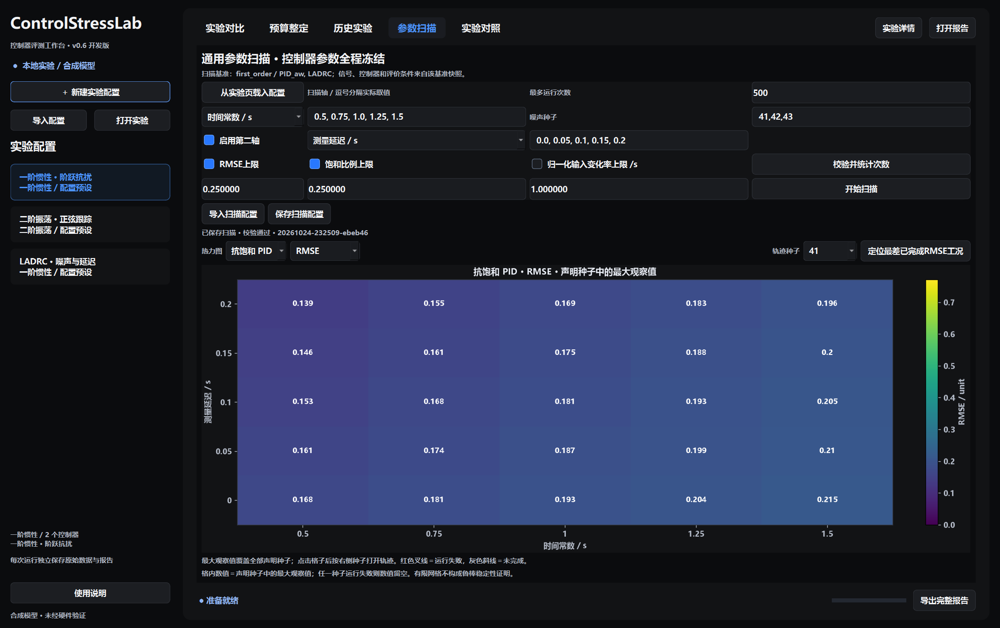
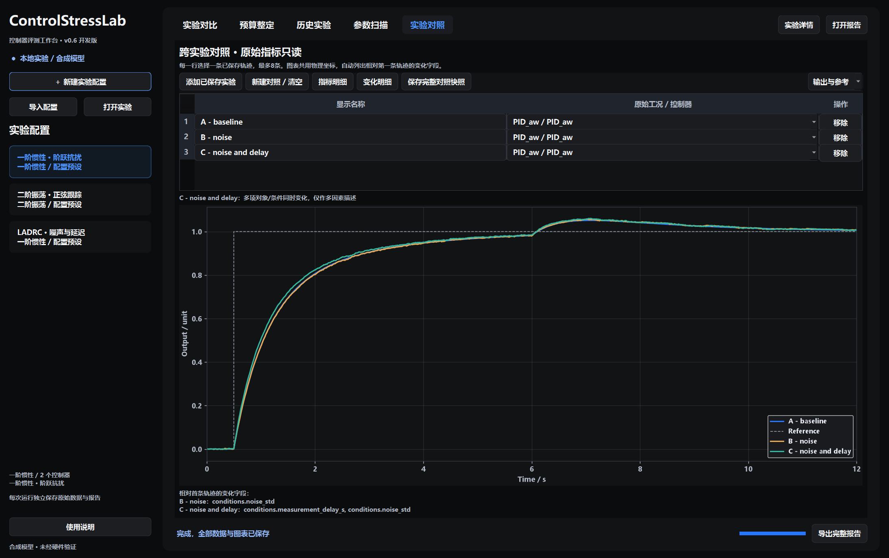

# v0.6通用扫描与跨实验对照

当前为0.6.0.dev0本地开发版。原启动器仍可使用：双击仓库根目录的 `Start-ControlStressLab.cmd`，或运行 `python run_gui.py`。需要Python与 `.[gui]` 可选依赖，免Python便携包尚未构建。

## 参数扫描

1. 在“实验对比”页配置一阶/二阶对象、选择控制器、参考/扰动和评价条件。
2. 进入“参数扫描”，点击“从实验页载入配置”。页面保留自己的基准快照，之后修改实验页不会偷偷改变该基准。
3. 选择1或2条轴，输入严格递增的实际取值；这些是实际参数值，不是相对名义值的倍率。
4. 输入噪声种子、最多运行次数，并预先启用至少一个要求阈值。
5. “校验并统计次数”会检查整个网格，确认时间对齐、对象参数、LADRC采样限制与资源预算后再开始。
6. 开始扫描后，在后台运行、生成图表与报告；可以请求取消，已有完整记录会保留。

支持扫描一阶增益/时间常数、二阶质量/阻尼/刚度、噪声标准差、测量延迟、非恒值扰动波形的幅值。控制器参数、参考尺度和其余条件全程冻结，不按网格点调参。

最多2条不同轴，每轴1～21个不同取值；种子1～10个；用户预算最多1000次运行，总推进区间不超过200万。总次数为轴取值数乘积×种子数×控制器数。无效配置在创建输出目录前拒绝，时间不自动取整。



## 如何阅读热力图

- 默认每格显示声明噪声种子中的最大观察值，各控制器使用同一指标色阶。
- 任一种子运行失败，格内数值留空并以红色叉线标记；未完成格为灰色斜线，不填0。
- “要求检查”分为满足要求、未满足要求、运行失败、未完成。只有全部声明种子都运行完成并满足全部启用阈值，该格才通过。
- 当前要求包括RMSE上限、饱和比例上限、归一化输入变化率上限；由用户事先声明，不是算法通用合格线。
- 点击某一格，按选定种子打开该工况全部控制器的响应、误差和实际输入。
- “定位最差已完成RMSE工况”只在成功完成的记录里找最大RMSE；失败单列，不把短轨迹计为更好表现。
- 修改扫描草稿后，地图仍显示原来保存的结果。再次运行才更新结果。

## 实验设计与适用范围

采用完整的笛卡尔网格，1或2个因素按预先声明水平组合。每个“网格点×噪声种子”是一组配对条件，控制器共享同一参考、扰动与预生成噪声。

不同网格点沿用相同噪声种子，噪声幅度变化时按同一随机基底缩放；波形自己的种子保持冻结。相同确定性条件反复运行不形成新的独立证据，时间采样点也不是独立重复实验。

运行顺序固定为轴索引、种子、控制器，便于定位与取消。各次运行使用新对象和新控制器并重置状态，结果与运行顺序无关；不把计算顺序当作物理时间或设备漂移。

阈值和网格保存在开始运行前的配置及 `plan.csv`。本轮没有根据结果调参再回用同一网格宣称留出验证，也不计算显著性、现实可靠性概率或连续参数域的稳定保证。

## 跨实验对照

进入“实验对照”，添加已保存的通用实验、覆盖实验、预算测试或扫描目录。每行选择一条原始轨迹，最多8条，可改显示名称。

页面叠加输出/参考、误差或实际输入，使用共用物理坐标。不同物理单位的轨迹禁止叠加；配置差异按第一条轨迹为基准逐项列出。

“变化明细”显示字段前后值，“指标明细”读取原始保存的指标和评价窗口。窗口、采样设置或归一化尺度不同时会提示指标不宜直接横比；多因素同时变化和来源软件版本不同时也会提示。不会用当前算法重算旧指标或自动给出因果结论。



“保存完整对照快照”在后台重新核验来源，复制原始CSV、配对输入、原始记录及来源清单，再生成HTML和3组PNG/SVG。源目录移走后，快照仍能独立打开。导入时的校验缓存不会代替导出前的新校验。

## 保存内容

新任务仍保存在 `outputs/gui/experiments/时间-随机编号/`；本机验收案例另存于 `outputs/gui-v06/experiments/`。

| 扫描 | 对照快照 |
|---|---|
| config.json、plan.csv | config.json、comparison.json |
| inputs/配对信号与噪声 | sources/来源清单、原始记录与配对输入 |
| runs/全部CSV及JSON | runs/复制的CSV及原始指标 |
| summary.json、summary.csv | metrics.csv |
| 每个控制器5组PNG/SVG | 输出、误差、实际输入3组PNG/SVG |
| report.html、manifest、status、checksums | report.html、manifest、status、checksums |

每次使用不存在的新目录，完整性状态最后提交。取消、写图失败或复制途中源数据变化都不能标记为完整。通过校验的完整报告可从底栏导出逐文件核对的ZIP。

## 命令行与独立核对

```sh
python -m controlstresslab.robustness --output outputs/my-scan --plots
python -m controlstresslab.robustness --config configs/robustness-first-order.json --output outputs/my-custom-scan --plots
python -m controlstresslab.comparison --config my-comparison.json --output outputs/my-comparison --plots
python scripts/check_scan_evidence.py --suite outputs/my-scan --output outputs/my-scan-audit.json
```

安装后入口为 `controlstresslab-robustness` 与 `controlstresslab-compare`。完整配置可以在GUI中保存后用于CLI；示例见 `configs/robustness-first-order.json` 和 `configs/robustness-second-order.json`。

对照配置格式：

```json
{
  "schema": "comparison-1.0",
  "entries": [
    {"folder": "outputs/run-A", "case_id": "PID_aw", "label": "干净基线"},
    {"folder": "outputs/run-B", "case_id": "PID_aw", "label": "加入噪声"}
  ]
}
```

独立审计不导入产品代码，检查完整网格、冻结参数、噪声配对、CSV指标、阈值分类和种子聚合；SciPy另做对象保持输入回放与LADRC矩阵核对。两者均不等于硬件验证或鲁棒稳定性证明。
