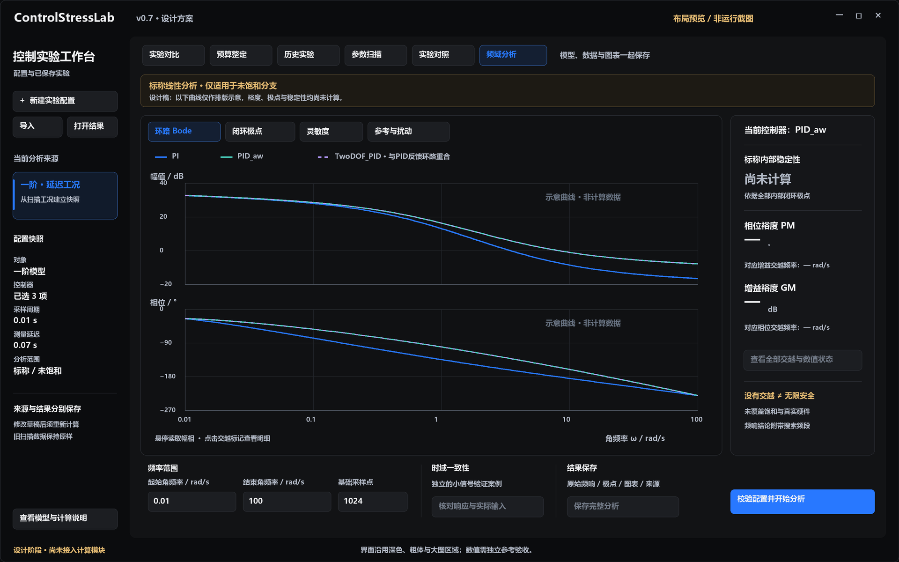

# v0.7设计：从压力测试到频域解释

> 历史方案/阶段记录；当前已实现范围及交付状态以[v1.0桌面指南](V1_0_DESKTOP_GUIDE.md)和[最终验收](V1_0_DESKTOP_VERIFICATION.md)为准。

设计日期：2026-10-25。状态：频域方案设计，尚未实现、测试或发布。本稿建立时源码基线为 `0.6.0.dev0`，当前开发状态见[路线图](ROADMAP.md)；公开稳定版本为v0.4.0。本文待办不代表已完成功能。

## 1. 这一版解决什么问题

v0.6已经可以回答“哪些参数组合下表现变差、哪条轨迹最差”。v0.7进一步回答：“在当前标称模型下，反馈环路有哪些频率特征？测量延迟怎样改变相位？参考跟踪和抗扰为什么会有不同表现？”

建议版本主题为 **频域分析与时域一致性核对**。新增一个分析工作台，把已有对象、实际数字PID实现、采样周期和测量延迟接到一起；保存可复算的模型、频响数据、极点、图表及验证证据。

项目继续面向通用单输入单输出控制，不绑定电机或列车。对复试展示而言，这一版形成“控制器实现 → 压力测试 → 频域解释 → 独立核对”的完整链条。

## 2. 范围与取舍

| 优先级 | 内容 | 完成后的用户行为 |
|---|---|---|
| P0，发布必需 | 一阶、质量-弹簧-阻尼二阶对象的采样模型 | 从实验配置或扫描工况建立分析快照 |
| P0 | PI、抗饱和PID、双自由度PID的未饱和线性模型 | 分析实际数字算法，保留测量微分和滤波时序 |
| P0 | 开环Bode、内部闭环极点、S/T及参考/扰动通道 | 在大图区域切换，查看单位和适用范围 |
| P0 | 增益/相位裕度、交越明细及明确的缺失状态 | 看到数值对应的频率和算法状态，不把空值当作安全 |
| P0 | 从v0.6扫描格进入分析、无饱和时域一致性核对 | 对同一个冻结工况交叉查看，不修改旧结果 |
| P0 | 原始数据、HTML、PNG/SVG、完整性清单、独立对照 | 保存并复查每张图背后的计算 |
| P1，P0通过后再评估 | 更多对照工况、交互式调参预览、Nyquist图 | 提高分析效率；不得占用P0验收时间 |
| 后续版本 | LADRC的完整离散观测器闭环、通用传递函数/状态空间导入 | 单独设计兼容性与数值验证 |
| 后续版本 | 鲁棒稳定性证明、MIMO、系统辨识与真实设备接入 | 需要新协议与证据，不在本版承诺 |

第一轮不同时增加大量对象和算法。LADRC仍可在已有实验/扫描页使用；进入频域页时明确显示“本版暂不支持该控制器的频域模型”，不能替换成近似PID。

P0每次只分析一个冻结工况，选择其中1～3个受支持控制器叠加。同一任务共享对象、采样周期、测量延迟、频率范围及单位。延迟变化采用两个独立任务，或从两格分别打开；本版不再增加通用的跨配置频域对照编辑器。

## 3. 用户流程

1. **建立快照**：从实验页载入，或在v0.6地图上选择“该工况 → 频域分析”。明确显示对象、参数、控制器、采样周期、测量延迟和来源。
2. **检查范围**：支持的控制器默认选中；不支持项显示原因。初始状态没有曲线、裕度或稳定性结论。
3. **设置频段**：输入正的起止频率和采样密度，默认rad/s。校验奈奎斯特上限及资源预算后开始；不偷偷截断或取整。
4. **查看结果**：Bode为默认页；切换闭环极点、灵敏度或参考/扰动通道。点击指标打开所有交越记录及计算状态。
5. **核对时域**：生成一个独立、无噪声、小幅值一致性案例，比较线性模型与原仿真器的逐点响应和实际输入。用户原来的压力实验不被重写。
6. **保存完整分析**：保存配置、模型矩阵、数据、图表、核对轨迹和报告。旧实验来自哪个版本、频域分析由哪个版本生成，分别记录。

修改草稿不改变正在显示的已保存结果。界面提示“配置已修改，重新计算后更新结果”；运行、取消和失败记账沿用现有后台任务框架。

## 4. 数学口径：与现有实现保持一致

下面是本项目实现的推导约定。实现阶段必须用独立参考程序验证，不能只对照本模块自身。

### 4.1 对象与采样

使用与当前仿真相同的零阶保持（ZOH）模型：

```text
x[k+1] = Ad x[k] + Bu,d u[k] + Bd,d d[k]
y[k]   = C x[k]
Gu(z)  = C (zI − Ad)^−1 Bu,d
Gd(z)  = C (zI − Ad)^−1 Bd,d
```

| 对象 | 连续矩阵 | 必须注意 |
|---|---|---|
| 一阶 | A=−1/τ；Bu=gain/τ；Bd=1/τ；C=1 | 控制输入与扰动输入的增益不同 |
| 质量-弹簧-阻尼 | A=[[0,1],[−k/m,−c/m]]；Bu=Bd=[[0],[1/m]]；C=[1,0] | 保留两个内部状态及现有物理单位 |

系数取自配置快照，不能根据响应曲线重新拟合。支持现有参数合法域，包括一阶零/负增益和二阶零阻尼；这些情况需要边界状态，不能直接贴“稳定”标签。

SciPy的 `cont2discrete` 提供ZOH等离散化方法；独立参考将显式指定 `method="zoh"`，不依赖默认值或误用双线性变换。[SciPy官方说明](https://docs.scipy.org/doc/scipy/reference/generated/scipy.signal.cont2discrete.html)

### 4.2 数字PID：不要套用连续PID公式

当前实现先更新待提交积分，再计算请求输入；微分作用于测量值，包含指数滤波。设 `q=z^-1`，`Ts=dt`，`a=exp(−Ts/τD)`；当τD=0时a=0。未限幅、未触发条件积分时：

```text
I(q)  = ki·Ts / (1−q)
D(q)  = kd·(1−a)·(1−q) / [Ts·(1−a·q)]
Cy(q) = kp + I(q) + D(q)
Cr(q) = kp + I(q)             # PI / PID
Cr(q) = beta·kp + I(q)        # 双自由度PID
u     = Cr·r − Cy·ym
```

`ki=0`不建立积分状态；`kd=0`不建立无作用的微分状态。保留真正参与算法的内部状态，不通过传递函数约消掩盖内部不稳定模态。

PID_aw的抗积分饱和逻辑在本模型中处于未激活分支。频域模型不描述进入饱和后的条件积分切换；不能据此宣称PID与PID_aw在大信号下等价。

### 4.3 测量延迟与各传递通道

当前延迟位于测量路径，噪声在延迟之前加入。令 `N=measurement_delay_s/Ts` 为经过现有配置校验的整数，`H=z^-N`：

```text
L       = Gu·Cy·H                  # 反馈环路
S       = 1/(1+L)                  # 灵敏度
T       = L/(1+L)                  # 互补灵敏度
Y/R     = Gu·Cr·S                  # 参考到真实输出
Y/D     = Gd·S                     # 对象扰动到真实输出
Y/Noise = −T                       # 延迟前测量噪声到真实输出
U/Noise = −Cy·H·S                  # 延迟前测量噪声到控制输入
```

不能把测量延迟移到执行器；也不能在对象本身的一拍状态推进之外多加一拍。由于微分作用于测量，`Y/R`通常不等于`T`；双自由度权重只改变Cr，固定其余参数时不改变L和反馈闭环极点。

P0主要展示L、S、T、Y/R、Y/D。噪声通道公式保存在模型说明中，交互绘图作为后续扩展；不把随机噪声的一条FFT当作精确频率响应。

### 4.4 稳定性与裕度分开报告

- **标称内部稳定性**：检查由对象、控制器有效状态和测量延迟组成的未约消闭环状态矩阵的全部特征值。离散极点须在单位圆内；接近单位圆时显示“边界/数值敏感”。
- 初始分类容差建议 `1e-8`：谱半径小于`1−tol`才标为内部稳定，大于`1+tol`标为不稳定，其余标为边界。矩阵残差、病态或参考不一致时改为数值不确定，不强行分类。容差及矩阵版本写入报告。
- **相位裕度PM**：在增益交越频率处计算；**增益裕度GM**：在负实轴相位交越处计算。GM保存线性倍数与dB，PM保存度，频率保存rad/s。
- 保留搜索频段内所有检出的交越及方法、残差、精化状态，界面展开明细。单一摘要采用明确记录的选择规则；没有经过验证的摘要规则时只展示列表。
- 指标缺失使用`null`和原因，例如`not_found_in_band`，不能写成0或“无限安全”。零传递通道的幅值为0，dB与相位分别标记为未定义，禁止用非标准JSON的Infinity/NaN。
- 正的GM/PM不替代内部稳定性检查；有限频段找不到交越不构成全频率保证。S/T的图上峰值仅称“当前频段采样最大值”，不称全局H∞范数。

python-control官方说明明确区分PM对应的增益交越与GM对应的相位交越，并说明频响数据只能找到给定频段内的裕度；其离散系统计算也存在数值方法选择。[官方裕度接口](https://python-control.readthedocs.io/en/latest/generated/control.stability_margins.html)

## 5. 数值计算与边界

- 频率必须满足 `0 < ωmin < ωmax < π/Ts`。Hz显示须显式使用`f=ω/(2π)`，存储仍用rad/s。DC与奈奎斯特端点不混入对数轴；端点特殊情形另记状态。
- 建议默认1024点，允许用户选择256～4096点；针对交越、共振峰和疑似相切点自适应精化，总上限16384点/控制器。达预算仍未收敛时保存未解决区间和`resolution_limited`，不返回看似精确的结论。
- 延迟相位使用解析项`−ωNTs`处理，不能对稀疏复数采样直接展开后漏掉整圈相位。滤波器、积分器和对象的相位分支也须记录并与参考核对。
- 不只靠相邻点变号搜索交越：检测近零、相切和多交越候选。对病态、高Q及极点邻域使用精化/残差检查；无法可靠判断就显式标记。
- 初始资源限额建议测量延迟不超过128拍、增广状态不超过160维、每任务最多3个控制器。数值预研后可以调整，但必须在正式配置中声明，超限在建目录前拒绝。旧仿真仍可运行其原有合法配置。
- 线性分析按零偏差平衡点定义；不覆盖饱和、非线性、时变参数、未建模动态或真实硬件。初值只影响时域核对，不改变本节的传递函数。
- 不在P0提供“最大允许延迟”的单一保证值；PM换算延迟的近似可能受多交越、采样和内部稳定性限制。

## 6. 时域一致性核对

核对要验证频域模型确实对应当前程序，不是另写一个更方便的PID。

1. 复制冻结的对象、控制器、Ts、测量延迟和真实输入限幅，生成独立验证案例。零初态、无噪声、无外扰，先有至少一个零输入/零参考采样，再施加小阶跃，以匹配首次微分初始化。
2. 在不改动原实验的前提下，逐级缩小验证阶跃，要求全程请求输入与实际输入一致且未触发抗饱和分支。保留最终幅值、缩放次数、步数及失败原因。
3. 比较实际仿真器与线性模型的每个y[k]、u[k]，同时核对延迟、终点无动作及积分更新时序。初始建议容差为`atol=1e-9, rtol=1e-7`，须以独立参考验证后冻结，不能针对失败样本逐条放宽。
4. 超预算、无法避免饱和或不满足初始化条件，显示“不适用/未通过”，不宣称已验证。对不稳定系统采用预声明短窗口和输出上限；提前中止照实保存。
5. 单独增加若干有限频率的正弦稳态幅相核对，声明预热与取样窗口；不把一次阶跃通过等同于全频段验证。

## 7. GUI布局与交互

[界面方案PNG](design/v0.7-frequency-workbench.png) · [可缩放SVG](design/v0.7-frequency-workbench.svg)。均为设计稿，示意曲线不来自仿真，指标保持空值，不能当作已实现功能的截图。



- 延续已确认的黑灰背景、蓝色强调、粗体文字；左侧保留配置/实验入口，顶栏增加“频域分析”。顶栏空间不足时滚动，不压缩到难以点击。
- 中央约三分之二以上的主工作面留给图表，Bode默认上下两幅共享对数频率轴；相位轴可以低于−360°，不能截掉延迟带来的变化。
- 右侧紧凑显示标称内部稳定性、GM/PM及各自交越频率、适用范围。缺失、失败、边界都用文字区分，不能只靠颜色。
- 图表子标签为“环路Bode / 闭环极点 / 灵敏度 / 参考与扰动”。极点页显示单位圆及全部内部极点，近边界可放大。
- 下方是冻结配置摘要、频段设置和时域核对入口。当前配置、结果配置及来源版本可展开查看；不在面板上堆叠所有数学推导。
- 图中悬停显示频率、幅值、相位和当前控制器，交越标记与指标明细联动。导出保留清晰的轴单位和模型边界说明。
- 在1280×800以及Windows125%/150%/200%缩放下验证。右栏及下方支持滚动/折叠，主操作、状态和错误信息始终可达。设计稿像素不作为固定窗口约束。

## 8. 数据结构与结果保存

建议新增结果schema `frequency-1.0`，配置schema `frequency-config-1.0`。这两个字符串为设计预留，当前读取器尚不支持。

建议配置包含：冻结的基础实验配置、所选控制器ID、频率范围及单位、基础点数/精化预算、数值容差、极点边界容差、验证案例设置、来源描述。

来源描述同时记录`source_kind`、原文件/目录指纹、原case_id、扫描轴实际值、原生产者版本；分析结果另记自己的软件版本、配置SHA256、模型编译器版本。若来自扫描，种子可作为原轨迹定位信息保留，但不影响无噪声标称频响。

```text
config.json                 # 分析前冻结的输入配置与预算
models/<controller>.json    # Ad/Bu/Bd/C、数字控制器、延迟及内部闭环矩阵
frequency/<controller>.csv  # ω、各通道复数实/虚部、幅值、相位及有效状态
poles.csv                   # 控制器、极点实/虚部、模长、分类
crossovers.csv              # 全部检出交越、类型、GM/PM、残差与状态
summary.json                # 内部稳定性、指标摘要、范围与数值诊断
validation/                 # 两套逐点轨迹、差值及可用/失败原因
figures/                    # Bode、极点、S/T、参考/扰动的PNG和SVG
report.html                 # 离线可读，公式约定和局限随结果保存
manifest.json / status.json / checksums.sha256
```

复数以实/虚部分列；非有限计算使用空值加状态，不以字符串假装数值。状态区分“文件完整”和“科学结论”：一个完整保存的报告可以包含unsupported、数值不确定或一致性失败，不等于分析通过。

复用现有完整性写入流程：拒绝覆盖；输入校验先于创建目录；取消保存已完成数据但不标完整；报告/图表出错不可提交完整状态；checksum最后覆盖所有应归档文件。历史读取器增加新schema分发，不修改旧版指标。

## 9. 代码拆分建议

| 建议位置 | 职责 |
|---|---|
| `src/controlstresslab/frequency_model.py` | 从已校验配置编译Gu/Gd、Cr/Cy、H及内部状态模型；不负责绘图 |
| `src/controlstresslab/frequency.py` | 配置校验、计算、精化、状态和结果写入，提供CLI入口 |
| `src/controlstresslab/frequency_plots.py` | 从保存的数据绘图，界面深色与报告白底共享单位和配色 |
| `src/controlstresslab/gui_frequency.py` | 页面、输入校验、来源快照、结果切换；计算走已有后台worker |
| `scripts/check_frequency_reference.py` | 不导入产品计算代码的独立ZOH、闭环矩阵和频响/裕度对照 |
| `tests/test_frequency.py` | 解析边界、时序、内部状态、数据状态及防覆盖等行为测试 |

NumPy作为分析可选依赖；SciPy和python-control用于独立参考。具体版本在实现与干净环境验证时记录，不在设计稿中虚构已安装/已通过状态。现有无第三方依赖的时域核心继续可用；GUI缺少分析依赖时显示安装提示，旧页面正常启动。

## 10. 验收矩阵

以下均为待执行标准，尚未验证。

| 类别 | 必须覆盖 | 判定依据 |
|---|---|---|
| 对象离散化 | 两对象，多Ts；正/零/负一阶增益；零阻尼二阶 | 对照独立SciPy ZOH矩阵及频响；零通道状态正确 |
| 数字PID | PI、PID_aw、TwoDOF_PID；ki=0、kd=0、τD=0/正值 | 原仿真与独立线性模型逐点匹配，不能多一拍 |
| 双自由度 | beta取0、0.6、1，其余冻结 | L、S/T及内部极点一致；Y/R按Cr变化 |
| 延迟 | N=0、1、7、上限；非法非整拍和超限 | 环路相位差为−ωNTs；上限和拒绝行为正确 |
| 内部稳定性 | 稳定、不稳定、近单位圆、外部约消隐藏状态 | 全内部特征值与独立矩阵一致，不用约消后的极点代替 |
| 裕度 | 无交越、单/多交越、近相切、延迟多圈相位 | 与python-control全交越结果匹配；候选残差和精化状态可查 |
| 数值失败 | 高频共振、预算耗尽、非有限/病态 | 显式resolution_limited或数值失败，空值不得写0 |
| 时域核对 | 无饱和通过、初次微分、延迟初始化、饱和无法消除 | 比较全轨迹；不适用与失败均不能显示通过 |
| 溯源与归档 | 实验快照、扫描选格、篡改来源、导出后删除来源 | 来源指纹可核验，快照独立可读，所有PNG/SVG及原始数据保留 |
| GUI | 空状态、支持/不支持混选、草稿变更、取消、导出失败、缩放 | 无虚假指标/百分比；后台计算不冻结窗口 |
| 回归 | v0.6扫描/对照、旧报告、无分析依赖的时域CLI | 原有约定不退化；Windows/Linux支持环境通过 |

参考对照容差在数值预研阶段写入协议并冻结；先列解析案例，再对代表参数集合交叉检查。不得先看完所有失败再调整容差、却把同一集合称为独立留出验证。

## 11. 分阶段执行与交付门槛

1. **数值预研**：验证采样PID推导和闭环内部矩阵，选定裕度算法及缺失状态；完成解析/独立参考协议。若此阶段不通过，不开始装饰结果界面。
2. **可保存的分析核心**：配置、资源限制、频响/极点/裕度、时域核对、事务式报告和CLI；独立参考通过后再接GUI。
3. **GUI与扫描联动**：实现本稿布局，冻结来源快照、进度取消、历史读取和图表导出；保留全部旧版本图片。
4. **发布验收**：运行新增与回归检查、真实Windows操作、独立环境复现、归档源代码和全部证据，再更新README/CHANGELOG并明确适用边界。

设计完成与发布完成分开记录。当前仅交付本文、界面方案图和路线图更新；不修改包版本、不创建v0.7标签、不上传GitHub。

## 12. 建议展示案例

先用一阶对象和PID_aw建立标称分析，再在保持增益/控制器/Ts不变的情况下增加测量延迟，分别保存结果；展示环路幅值不变、相位发生变化，并回到v0.6轨迹看时域表现。具体参数与曲线必须计算后选择，不提前编造“延迟X毫秒必然失稳”的数字。

再用TwoDOF_PID改变beta，展示反馈裕度和极点不变而参考跟踪改变。这比单纯增加算法数量更能体现对反馈结构和实现细节的理解。
