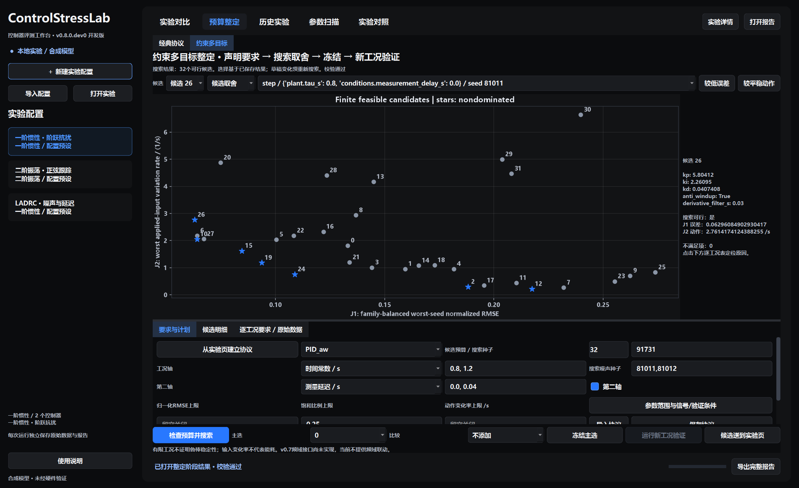
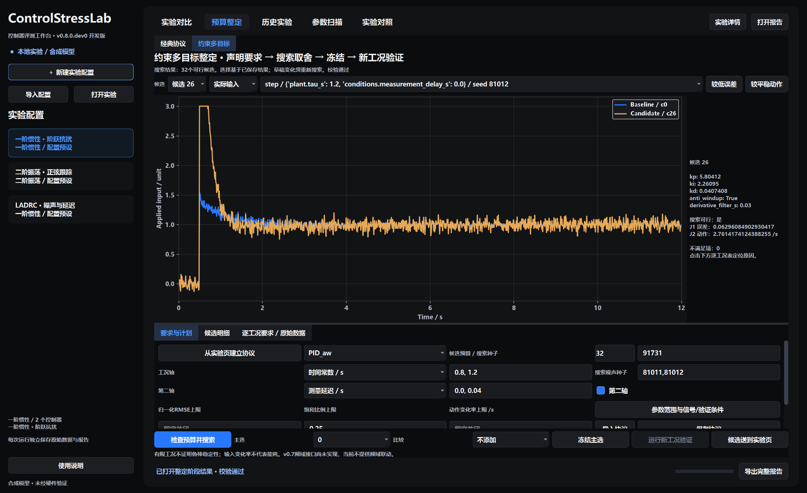
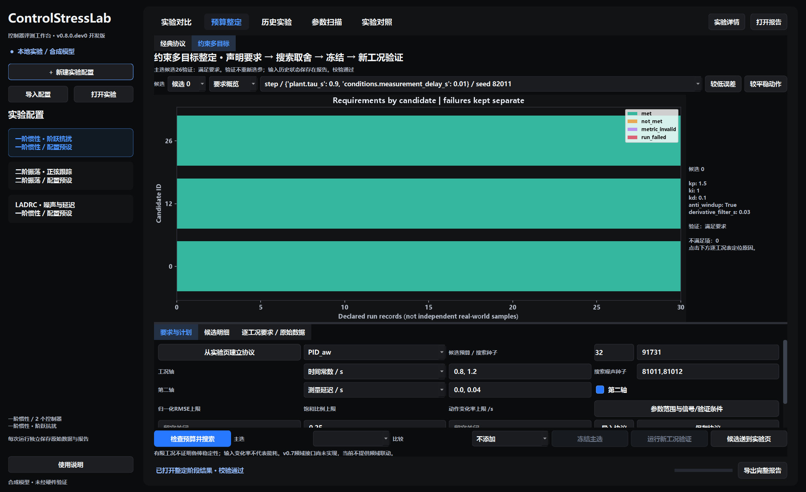

# v0.8本机验收记录

日期：2026-10-25。版本0.8.0.dev0，本地开发；尚未发布GitHub。以下区分实际完成的检查与未覆盖范围。

## 实际实现和测试

已实现要求声明、有限多工况候选搜索、双目标非支配比较、逐工况越限定位、主选冻结与新工况验证，以及完整数据/图表/报告归档。

最终全套190项测试通过（含16项整定核心测试、14项Qt交互测试；原有时域、经典整定、扫描、跨实验对照回归包含在总数中）。整定Qt新增3项，覆盖真实按钮/后台进程的搜索→冻结→验证、候选身份关联、不可行/损坏结果禁用操作。

测试包含重复输入/零噪声换种子、基线不裁剪、候选别名、族权重、最坏种子、前沿并列、阈值等号、失败空值、无可行不回退、来源变化、验证输出嵌套拒绝、观察历史、取消、写图失败、完整ZIP及篡改指标后同步改checksum仍被独立复算发现。

最终日志：`outputs/v08-final-tests.log`。早期188项日志保留在`outputs/v08-full-tests.log`；新增两个负例检查遗漏工况及篡改PID请求但保持实际输入不变。本地安装包已在源码目录外完成搜索、冻结、验证三个命令的小协议运行。未执行本版GitHub Actions，也未验证免Python便携EXE或干净机器安装。

## 真实Windows工作流

原生Qt窗口实际执行，未使用设计图替代截图。事件循环记录1122次心跳；计算在子进程中运行，完整结果载入和绘图期间最大心跳间隔约2.0 s，因此不宣称界面所有阶段均无停顿。

| 案例 | 实际闭环记录 | 结果与范围 |
|---|---:|---|
| 一阶PID_aw搜索 | 768 | 32候选×24条件；32个可行，非支配ID为2、10、12、15、19、24、26 |
| 同一阶冻结后的验证 | 90 | 事先主选26、比较12、基线0，各30个新条件；主选在声明验证条件中满足要求 |
| 二阶TwoDOF_PID搜索 | 384 | 16候选×24条件；16个可行；本次原生窗口未运行二阶大协议的冻结验证 |
| 输出上限注入失败 | 2 | 两条中止记录，指标空值，无可行候选，冻结入口禁用；不是物理失稳边界实验 |

主选规则在运行前的验收脚本中固定为搜索J1较低者；比较规则为J2较低者。没有根据验证结果更换主选。原始记录位于`outputs/v08-verification.json`列出的独立目录。

一阶搜索的实际取舍（仅本协议）：

| 参数方案 | J1，族等权最坏种子误差 | J2，最坏动作变化率 /s |
|---|---:|---:|
| 基线0 | 0.1331206353 | 1.8113957147 |
| 主选26 | 0.0629608490 | 2.7614174124 |
| 比较12 | 0.2174925052 | 0.2104865965 |

这展示了误差与动作的取舍，不是所有指标同时改善。以上是搜索阶段目标，不把它们与不同波形/窗口的验证目标直接相减。

## 独立复算

另一个环境Python3.9.13、NumPy1.21.5、SciPy1.9.1，不导入产品计算模块：

- 四个结果集共1244条原始闭环记录通过独立CSV/配对/PID动作/要求审计；搜索集另核对目标聚合与非支配ID。
- 其中1242条完整轨迹通过SciPy ZOH对象保持输入回放，一阶搜索768、验证90、二阶搜索384，数值对照失败0。
- 故意中止的2条不计入SciPy通过数；现有参考脚本明确返回`incomplete_product_run`。其失败空值和不可行处理通过独立审计。
- 指标重算最大绝对差：一阶4.55e−13以内、验证2.14e−13以内、二阶1.14e−12以内。

独立PID审计重新计算可用测量、测量微分/滤波、先积分后请求、输入限幅和条件积分，覆盖两种对象及实际测试中的饱和/解饱和。SciPy部分是记录实际输入后的对象回放，不是另一个独立闭环实验或硬件验证。

## 图片和完整证据

四个任务共生成25组PNG/SVG：一阶搜索8、验证7、二阶搜索8、失败案例2；另保留8张真实桌面截图。

其余截图：[响应](design/v0.8-candidate-response.png)、[冻结选择](design/v0.8-frozen-selection.png)、[验证响应](design/v0.8-validation-response.png)、[二阶搜索](design/v0.8-second-order-tradeoffs.png)、[无可行方案](design/v0.8-no-feasible-candidate.png)。旧版本图片保留。

归档入口为`outputs/ControlStressLab-v0.8-dev-evidence-20261025.zip`，归档清单与SHA256保存于`outputs/v08-archive.json`。归档包含完整搜索/冻结记录/验证快照、二阶/失败案例、原始CSV/输入、PNG/SVG、源码及审计/测试日志。

## 当前边界

v0.7频域功能尚未实现，新GUI明确说明当前无频域联动；LADRC仍可用旧实验/经典整定，本模式暂不支持。未实现通用传递函数导入、连续参数域的鲁棒稳定性证明、硬件接入、跨算法公平排行榜或断点续算。

验证观察历史只覆盖当前输出根目录及用户显式提供的已观察指纹，不能发现其他机器/软件中的信息使用。校验和只发现内容变化，不构成防恶意篡改或第三方盲测证明。
