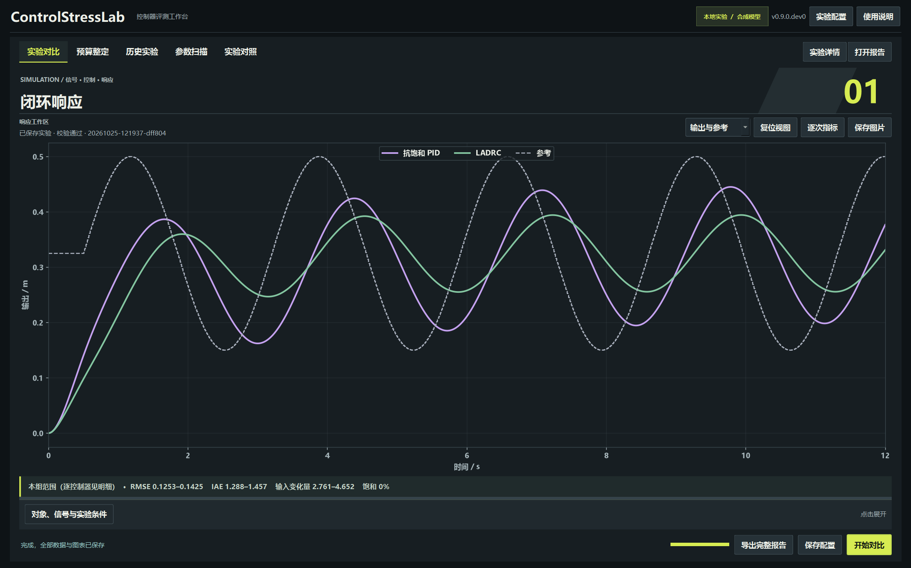
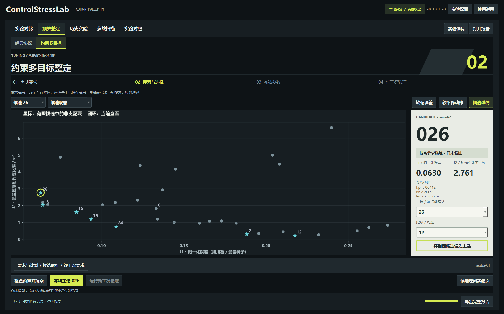
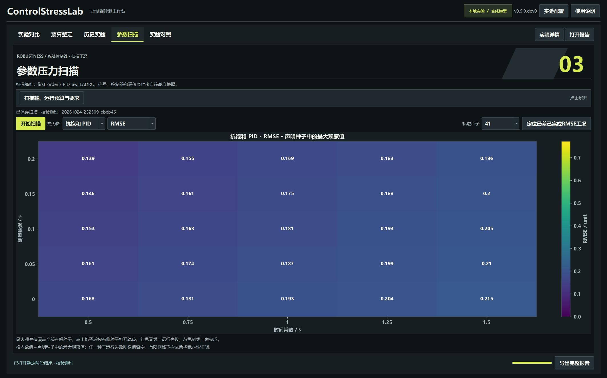

# v0.9 本地GUI改版与验收

日期：2026-10-25。源码版本：**0.9.0.dev0**。本轮修改已接入桌面程序；以下图片均来自真实 Qt 窗口，不是静态设计稿。

## 已实现的变化

- 主窗口使用紧凑顶部导航；原固定实验配置列表改为“实验配置”侧边抽屉。
- 响应曲线占据主工作区；对象、信号及实验条件可以收起，首次启动立即显示真实配置信号预览。
- 采用深灰主画面、纸白候选详情与少量黄绿操作强调；大标题、页面编号、关键指标与辅助说明分层。
- 整定页显示要求、搜索、冻结、验证四个实际阶段；当前候选用圆环定位，非支配项使用星标。
- 候选详情展示编号、搜索/验证状态、原始 J1/J2、参数与主选/比较选择。可以收起详情，将空间交还图表。
- “将当前候选设为主选”与“冻结主选 XXX”分别执行选择和确认；查看某个候选不会自动冻结参数。
- 参数计划、候选表和逐工况要求放在可展开区域，保留点击定位与原始 CSV 入口。
- 扫描、跨实验对照、历史档案使用同一视觉体系；扫描设置和对照来源表可以收起。
- 窗口较小时压缩标题区，并提供页面滚动和详情滚动；控件不再互相覆盖。

## 启动与操作

双击仓库根目录的 Start-ControlStressLab.cmd，或运行 python run_gui.py。仍使用已有 Python 与 GUI 依赖。

主界面的“实验配置”打开预设和导入入口；“对象、信号与实验条件”展开参数。选择“预算整定 → 约束多目标”查看整定流程。“候选详情”控制右侧面板；“要求与计划 / 候选明细 / 逐工况要求”展开下方数据区。

在较小窗口或高像素缩放下，滚动页面可以到达下方的冻结/验证操作。展开按钮可用 Tab 聚焦、空格操作。

## 实际窗口

### 闭环响应

本轮从桌面按钮启动了一次二阶对象实验；图中轨迹来自该实验保存的数据。首次启动的信号预览明确标注“尚未使用此配置运行响应”。

### 候选取舍

读取 v0.8 已保存的32候选/24条件搜索结果。截图查看候选26，手动设置主选26、比较12，尚未冻结或运行新验证。参数选择与冻结操作分开；“搜索要求满足”不等于新工况验证通过。

### 扫描与对照

[跨实验对照](design/v0.9-gui-experiment-comparison.png) · [纯图表视图](design/v0.9-gui-chart-focus.png) · [原始要求明细](design/v0.9-gui-requirements-detail.png) · [冻结未验证](design/v0.9-gui-frozen-selection.png) · [验证结果](design/v0.9-gui-validation.png) · [没有可行候选](design/v0.9-gui-no-feasible-candidate.png) · [150%缩放](design/v0.9-gui-150-percent.png)。

## 验证结果

- **完整191项测试通过**，其中15项是 Qt 交互及真实子进程检查；最后的对照页排版调整后又运行15项 GUI 回归。
- 原生 Windows Qt 平台完成实验按钮运行、候选选择、主选设置、阶段查看、工况定位、扫描及跨实验同轴对照，未记录 GUI 错误。
- 本机原生窗口实际像素比为1.25；另一个独立原生进程核对像素比1.5。100%使用离屏 Qt 回归检查，不能将其表述为原生Windows 100%显示设置验收。
- 在1080×720逻辑窗口核对下方操作可经页面滚动到达；1280×800、像素比1.5核对空格展开/收起，配置保持一致。
- 保存 **19张实际窗口截图**，均以 v0.9-gui- 开头；前几轮图片保留。
- 新版整定图表画布在1700×1060逻辑窗口、详情展开时为1334×491逻辑像素；收起详情后横向空间继续增加。
- 对此前5个v0.8实验目录的 **4520个文件**逐个计算校验值，修改前后一致；没有覆盖旧轨迹、报告和选择记录。

本机详细记录：outputs/v09-tests.log、outputs/v09-gui-final-tests.log、outputs/v09-gui-verification.json、outputs/v09-scale-verification.json。配置、截图路径与新的按钮运行实验目录均写入记录。

本轮只改变桌面组织、显示与交互，未改动仿真、优化目标或冻结验证协议。原图表报告保持自己的科学绘图样式；新桌面颜色不追写历史报告。

## 版本范围

这是本地开发版，尚未提交到GitHub或运行本轮线上CI；公开稳定版仍为v0.4.0。免Python便携包与干净机器验收仍待完成，v0.7频域功能仍未实现。跨设备显示效果还需要更多机器检查。

视觉依据见[全量资源研究](design/V0_9_FULL_REFERENCE_STUDY.md)。参考中的构图与层级经过重新设计，产品没有嵌入原站人物、标志、宣传图或纹理。

