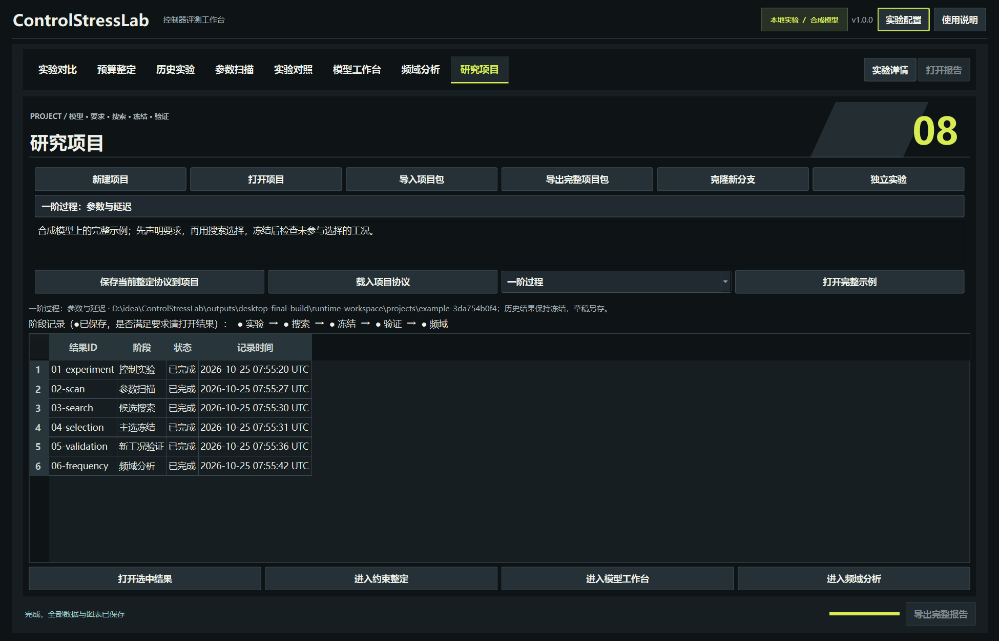
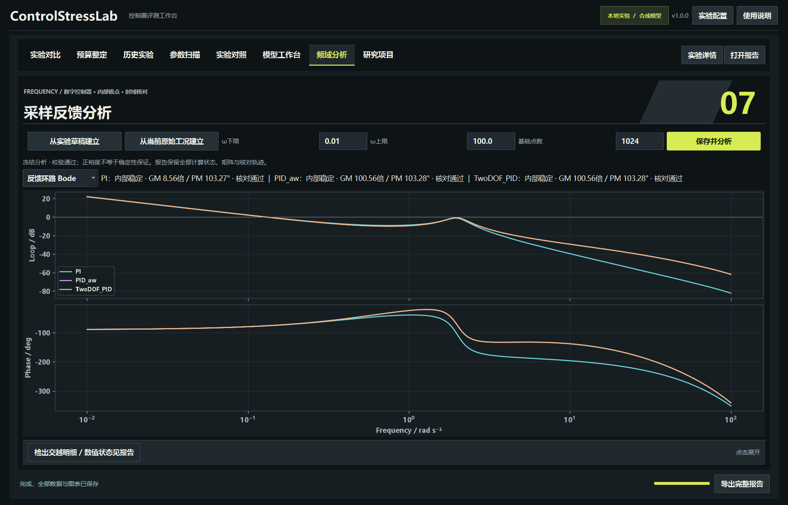
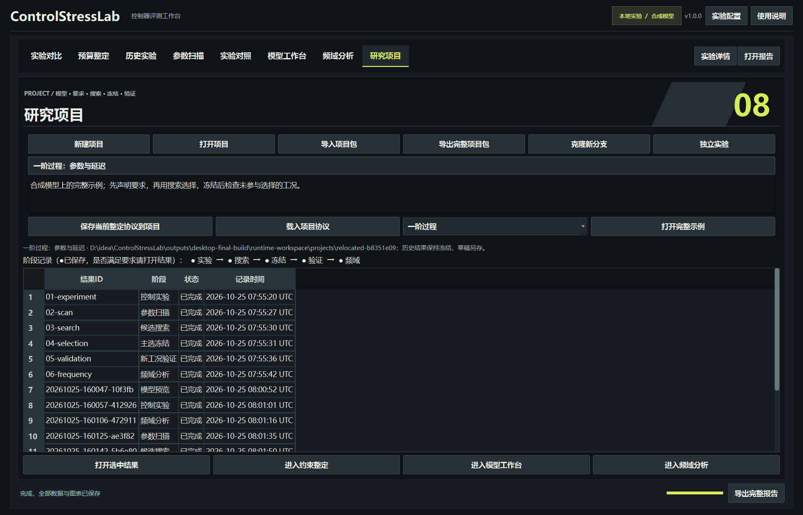

# v1.0 Windows桌面版

> 2026-10-26发布更新：v1.0.0的公开安装包与校验清单见[GitHub Release](https://github.com/yuz237177-cyber/ControlStressLab/releases/tag/v1.0.0)。下文的本机验收记录保留其执行时范围；线上状态以[Actions](https://github.com/yuz237177-cyber/ControlStressLab/actions/workflows/tests.yml)为准。

v1.0.0已完成本机独立桌面交付。解压完整Windows x64便携包，双击ControlStressLab.exe即可运行，**无需安装Python或桌面依赖**。保留同目录的_internal文件夹。

本轮已完成通用建模、数字PID频域分析、项目组织/迁移和桌面整合。全部示例为合成仿真，不代表硬件实测。

## 第一次使用

1. 进入“研究项目”，选择一阶过程、二阶振荡或自定义四阶示例，点击“打开完整示例”。
2. 双击阶段列表查看控制实验、参数扫描、搜索、冻结、验证或频域结果。示例复制到个人工作区，原包保持不变。
3. 到“模型工作台”输入自己的对象；模型系数与通道口径见[建模说明](V1_0_GUIDE.md)。
4. 在实验页选择控制器和信号；在约束整定页声明工况、候选范围与要求。
5. 从搜索中确定主选、填写选择依据并冻结，再运行未参与选择的新工况。验证不重新排名选参。
6. 导出.cslproj完整项目包，在另一目录导入后可查看原记录、继续验证或建立新分析。



默认工作区为当前用户的%LOCALAPPDATA%/ControlStressLab；项目页显示实际路径。仓库根启动器优先使用便携EXE并保留原outputs/gui工作区；缺少便携包时回退源码启动。项目“独立实验”按钮切回普通实验历史；项目创建后新任务自动记录到该项目。

## 频域分析

从实验草稿或当前已保存的原始工况建立配置，输入正的频率上下限，开始分析。支持PI、抗饱和PID和双自由度PID；LADRC未建立本轮频域模型。



- 反馈环路Bode：对应真实采样、测量延迟、测量微分及其滤波时序。
- 内部极点：保留对象内部模式和控制器有效状态，按单位圆及1e-8边界容差分类。
- S/T、参考/扰动通道：区分参考权重与反馈环路；Y/R通常不等于T。
- GM/PM：显示频段内检出的交越和数值状态，缺失不当作0或无限安全；摘要按绝对裕度接近零选择。
- 每个控制器保存与原仿真器的逐点小阶跃核对，以及可用时的正弦幅相核对。

分析采用未饱和、固定参数的线性分支；正裕度不代替内部稳定性、压力测试或鲁棒稳定性证明。非有限样本、相位变化过快或精化未解决会标记数值状态，不输出可靠裕度摘要。灵敏度峰值是当前频段采样最大值。

采样频率严格限定为0<ωmin<ωmax<π/Ts；默认rad/s，延迟最多128拍。基础网格256～4096点，保存/搜索网格预算最多16384点，须比基础点数至少多64点以容纳极点邻域。标量交越精化使用有界数值例程，另有迭代次数；有限采样不证明发现了所有可能的交越。保留设计稿中的Nyquist、根轨迹与LADRC频域作为后续扩展。

来源工况保留原生产者和文件指纹；分析另存自己的版本和源码。来自原始工况的分析保存来源副本（上限512MB）；单独迁移分析目录或项目后，可以按冻结内容重建草稿路径，不改写原来源记录。

## 项目、冻结与迁移

项目首页保存问题、模型快照和协议草稿；各运行目录分别冻结配置、矩阵、指标、CSV、图片、状态和源码指纹。阶段标记表示已生成完整记录，不表示要求满足；实际结论见阶段结果。



冻结收据保持原文，包含主选/比较候选、选择依据及验证计划指纹。项目移动后，按原搜索指纹定位本地副本，不重写冻结依据。验证结果含搜索和选择的独立证据副本。

导出包含项目索引、模型、协议、全部结果、图片/轨迹、观察登记及任务日志，逐文件校验。导入拒绝越界路径、重复路径和内容损坏；最多30000文件、展开后1GB。已有目录和文件不覆盖。

克隆新分支继承已观察输入；需重新声明验证条件，不能把看过的验证集称为新数据。仅改模型名、单位标签或等效数值表示不会产生新的验证输入身份。工作区之外的观察历史仍需主动登记。

## 桌面交付范围

已在本机Windows11 x64上，清空PYTHONPATH/PYTHONHOME并将PATH限制到Windows系统目录后，启动迁移到中文/空格目录的程序。主程序和后台任务均来自同一便携包，完成预览、实验、扫描、搜索、冻结、验证、项目导入导出及迁移后重算；125%/150%/200%缩放与小窗口检查通过。

这不是另一台全新Windows机器的测试。异机、不同显卡及干净Windows环境的进一步复测尚待执行；本轮没有上传GitHub或创建公开Release。

完整数据与校验见[交付验收](V1_0_DESKTOP_VERIFICATION.md)。便携目录中的“使用说明.html”可以离线打开。

## 从源码构建

```sh
python -m pip install -e ".[gui,build,reference]"
python -m unittest discover -s tests -v
python scripts/build_desktop.py --verify
```

需要Windows x64。构建过程生成三套完整示例、打包依赖、迁移后实际运行、两档额外缩放检查、原始截图、文件清单和ZIP校验。工作目录在outputs/desktop-final-build，交付在dist/v1.0.0；遇到已有交付目录会拒绝覆盖。重复构建请指定新的--output和--work。
