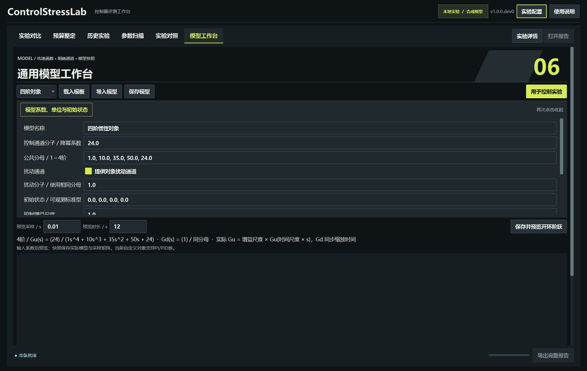
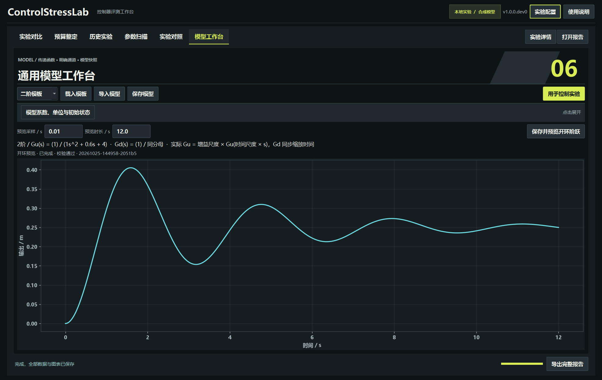
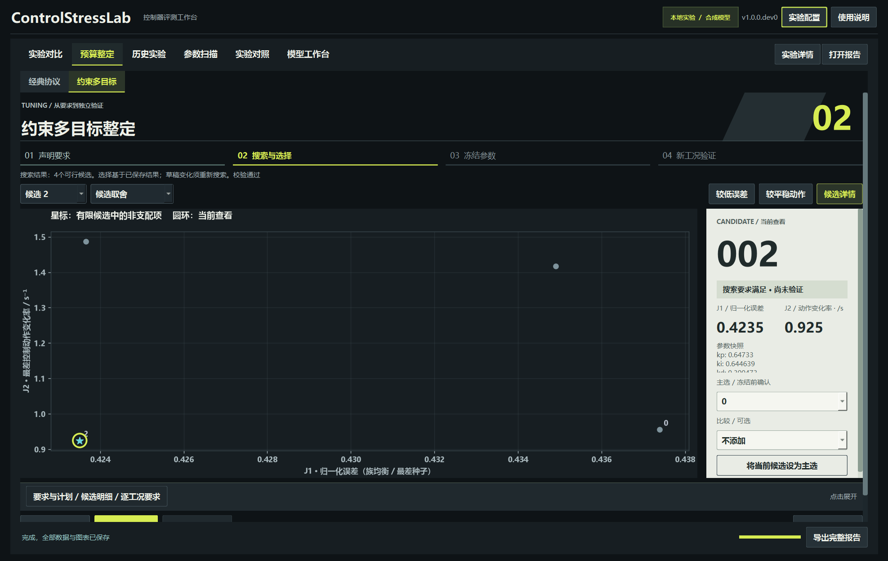

# v1.0 M1：通用模型工作台使用说明

当前源码：**1.0.0**。本页说明通用模型的数学口径；频域、项目与独立桌面包已接入，完整使用入口见[桌面指南](V1_0_DESKTOP_GUIDE.md)。

## 从桌面开始

按仓库原有方法双击 `Start-ControlStressLab.cmd`，或：

```sh
python -m pip install -e ".[gui]"
python run_gui.py
```

进入顶部“模型工作台”。可载入一阶、二阶、积分或四阶模板；填写名称、分子/分母、扰动通道、初始状态和单位。系数按降幂输入，支持英文/中文逗号和JSON数组。

点击“保存并预览开环阶跃”，后台计算控制输入为1、扰动为0的开环响应，保存原始CSV、模型快照、PNG/SVG和报告。预览期间界面继续响应，可通过底部运行按钮取消。



收起“模型系数、单位与初始状态”可以放大曲线。修改系数后，图仍显示上一次保存的预览，提示会标记草稿已变；再次运行预览才更新图表。



点击“用于控制实验”载入当前模型。**闭环采样、时长及评价窗口采用实验页默认条件**，开环预览的时长只用于预览。请在实验页设置实际控制条件与PI/PID参数后运行；程序不会据模型自动猜测合适增益或控制方向。

## 模型的数学口径

本轮支持连续、实系数、SISO、1～4阶、严格真有理传递函数，无直接输入到输出通道：

```text
Gu(s) = gain_scale × Nu(time_scale × s) / D(time_scale × s)
Gd(s) = Nd(time_scale × s) / D(time_scale × s)
y = Gu u + Gd d  （零初始状态下）
```

控制与扰动可以使用不同分子，共享声明的分母。`gain_scale`仅缩放控制通道；`time_scale > 0`同时缩放两条通道的时间。不进行极零抵消，保留声明分母中的内部模式。开环不稳定、积分环节和零/负增益可以合法录入；合法模型不保证给定控制器能够控制它。

分母首项非零；归一化系数限于±1e8，增益/时间尺度绝对值限于1e6。分子允许高次项的零前缀，实际阶数必须小于分母；快照保留原始数组。数值矩阵不可计算时，在建立实验目录前拒绝。预览为1～5000个完整采样区间，闭环仍遵守原有总采样预算。

不提供扰动通道时，取消“提供对象扰动通道”。保存值为 `null`；闭环非零扰动会明确拒绝。整定默认只建立参考跟踪工况，不生成不存在的扰动通道。

单位分别声明输出、控制输入和扰动输入。它们是标签，软件不自动换算量纲。用户需要保证系数与单位相符。

## 初始状态与采样矩阵

内部采用**可观测标准型**，输出为 `x[0]`。长度必须等于分母阶数；这些数不是任意物理坐标。

对于模板的一阶对象，状态为初始输出。二阶物理对象在时间尺度为1时：

```text
x[0] = 初始位移
x[1] = 初始速度 + (阻尼 / 质量) × 初始位移
```

改变时间尺度时，标准型状态保持声明值，不自动保持某个物理初始速度。

连续矩阵含两个输入列，顺序固定为控制、扰动。采样采用增广矩阵指数实现零阶保持，不依赖对A求逆，因而支持积分对象。依据：[SciPy离散化文档](https://docs.scipy.org/doc/scipy/reference/generated/scipy.signal.cont2discrete.html)、[传递函数与状态空间表示](https://docs.scipy.org/doc/scipy/reference/generated/scipy.signal.tf2ss.html)。

`model-snapshot.json`保存原模型、定义指纹、连续/采样矩阵、采样周期、开环极点和NumPy/SciPy版本。模型预览和单次实验各保存一份；扫描、搜索和验证为每个不同模型/采样条件保存 `models/<指纹>.json`，每条运行记录关联对应文件及校验值。编辑草稿不会修改历史快照。

## 接入原有流程

自定义对象支持PI、抗饱和PID和双自由度PID，可运行单次实验、增益/时间尺度扫描、约束搜索、主选冻结及新工况验证。LADRC仅保留原有内置对象用法，自定义对象上的兼容性尚未定义，界面会禁用。



扫描轴增加“控制增益尺度”“模型时间尺度”，还可以使用已有噪声、测量延迟和扰动幅值轴。默认围绕时间尺度建立搜索条件，能够覆盖零/负控制增益的合法模型。PID族沿用原有非负增益参数范围；本轮未提供自动控制方向切换，错误方向导致的越界/数值失败会保留在结果中。

验证输入指纹使用连续标准型矩阵、初始状态、采样、限幅、延迟及实际参考/扰动/噪声序列。仅修改模型名、单位标签，或得到相同标准型矩阵的系数写法，不构成新验证工况。该去重是数值表示层面的保护，不是任意不同状态坐标/模型类别的符号等价性证明；工作区之外的观察历史仍需研究者主动登记。

## 命令行与复现配置

```sh
controlstresslab-model-preview --config configs/model-preview-fourth-order.json --output outputs/my-model-preview --plots
controlstresslab-experiment --config configs/experiment-transfer-function.json --output outputs/my-custom-experiment --plots
controlstresslab-tune --config configs/tuning-transfer-function.json --output outputs/my-custom-search --plots
```

输出目录必须是新目录。可用已有freeze/run命令或桌面操作冻结主选后运行验证。模型JSON导入/导出使用 `model-definition-1.0` 格式，包含 `schema` 和 `plant`；开环预览配置则包含 `plant`、`dt_s`、`duration_s`。

只使用原有内置对象的命令行实验仍可不安装第三方数值依赖。通用模型需要 `.[analysis]`；绘图需另装 `.[charts]`；`.[gui]`包含桌面及通用模型依赖。

## 完整桌面版

频域分析、可迁移项目包、项目主页和无需安装Python的Windows便携包已完成本机实现与验收。详见[桌面指南](V1_0_DESKTOP_GUIDE.md)和[交付验收](V1_0_DESKTOP_VERIFICATION.md)。M1阶段的历史证据见[M1验收](V1_0_M1_VERIFICATION.md)。
