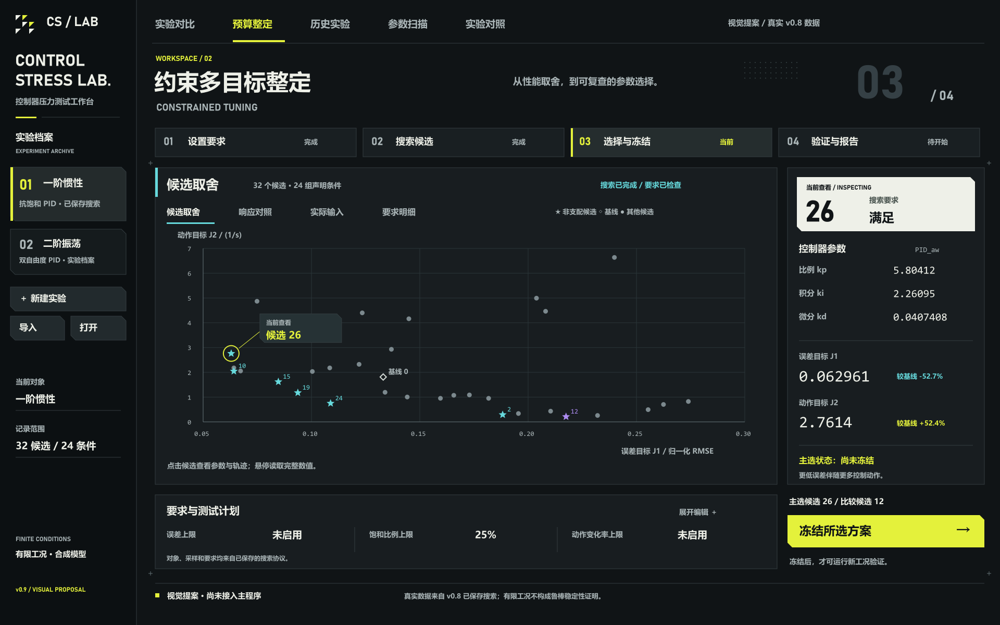

# v0.9视觉方向：参考方舟美术资源的工程工作台

> 后续实施更新：现已依据本研究接入0.9.0.dev0桌面界面，见[实际窗口与验收](../V0_9_GUI_GUIDE.md)。下文的未实现描述保留为研究/首稿阶段记录。

> 首轮探索留档：用户认为这一稿参考深度不足。后续已完成指定页面 96 组、2358 张图片的缩略总览，以及选定原图/动图代表帧研究，见 [全量研究与布局修订依据](V0_9_FULL_REFERENCE_STUDY.md)。下文保留首稿的原始查看范围和设计，不代表当前定稿。

日期：2026-10-25。状态：资源学习、视觉规范与首版设计稿，尚未接入主程序。当前产品源码仍为0.8.0.dev0；本轮没有修改仿真、整定、冻结或验证逻辑。

## 参考来源与实际查看范围

按用户指定的[明日方舟美术资源系统](https://www.ignoredone.space/index.php/arknights_design/)查看资源。页面通过公开接口动态加载，实际读取页面及资源索引，并选看7组封面和4份《矢量突破》详细图；并未逐一审阅整个资源库。

本次主要参考[《矢量突破》2024/0926资源组](https://www.ignoredone.space/index.php/arknights_design/?path=arknightsdesign/2024/0926)：

- [资源总览长图](https://cdn.ignoredone.cn/arknightsdesign/2024/0926/001.jpg)：观察黑灰分区、编号、功能卡和黄紫强调。
- [活动平面图](https://cdn.ignoredone.cn/arknightsdesign/2024/0926/004.jpg)：观察大字、方格、箭头与斜切构图。
- [活动界面](https://cdn.ignoredone.cn/arknightsdesign/2024/0926/008.png)：观察模块入口、黑白反差、阶段与状态。
- [完成状态](https://cdn.ignoredone.cn/arknightsdesign/2024/0926/012.png)：观察大编号、粗体排版、方向线与明确的完成反馈。

以上是视觉分析来源。下面的色值、尺寸及控件做法是针对ControlStressLab的重新设计，不是该游戏的官方GUI规范。参考预览留在忽略目录`outputs/design-references/arknights/`；交付稿不嵌入第三方人物、标志、宣传图或纹理。

## 设计主线

采用 **黑灰底色、少量纸白反差、荧光黄主操作、蓝青色数据、紫色比较方案**。用编号、粗体、边界和空间组织信息，形成有识别度的控制实验工作台。

用户此前确认的粗体文字和大图区域继续保留。主工作区约75%的横向空间分给图表面板；参数摘要移到下方，候选上下文置于右侧。实际Qt实现必须允许缩放、折叠和滚动，不能把设计稿像素固定为窗口尺寸。

## 首版视觉稿

[PNG](v0.9-arknights-workbench.png) · [SVG](v0.9-arknights-workbench.svg) · [数据来源说明](v0.9-arknights-workbench.json) · [设计变量](v0.9-theme.json)。

这是静态视觉提案，不能作为已实现界面的截图或交互验收证据。图中的点击、悬停、展开和冻结按钮是拟实现的交互文案。

散点直接使用已保存的v0.8一阶搜索结果，包含32个候选和24组输入条件。图中当前查看为搜索误差目标较低的候选26，比较方案为动作目标较低的候选12，基线为0。原始J1/J2及来源summary的SHA256写入配套JSON，没有生成新的仿真曲线或修改原记录。

“搜索要求满足”只描述搜索阶段；阶段条停留在选择与冻结，主选状态明确为“尚未冻结”。不能把搜索合格绘制成新工况验证已经通过。

## 元素如何转化为GUI

| 参考中的视觉元素 | 工作台中的应用 |
|---|---|
| 大字号与大小对比 | 页面主标题、阶段编号、当前候选ID |
| 黑白大块对比 | 当前候选概览使用纸白面板，参数和图表使用深灰 |
| 黄/紫色功能区 | 荧光黄表示主要操作/当前阶段，紫色标记比较候选 |
| 方格、三角与斜切 | 原创品牌小图形、少量按钮切角、面板外侧角标 |
| 导向箭头 | 阶段推进及冻结操作，不叠加在数据曲线上 |
| 深色网格与纹理 | 装饰只放在标题/空状态边缘；坐标区保留清楚、低对比的科学网格 |

所有按钮和面板不必使用同一种切角。主按钮、选中实验卡可以切角，输入框和表格采用简单矩形；避免装饰占用输入区域或改变点击范围。

## 颜色角色

| 角色 | 本项目拟用色值 | 使用原则 |
|---|---|---|
| 窗口底色 | `#101416` | 主背景 |
| 侧栏底色 | `#0C1012` | 与主面板轻微分层 |
| 面板 | `#181D20` | 大图、参数、要求摘要 |
| 边界 | `#343D41` | 弱分割线 |
| 主文字/纸白 | `#EEF0E8` | 主文字，少量反白区域 |
| 次文字 | `#AAB5B7` | 单位、来源、辅助说明 |
| 主强调 | `#E4F13B` | 当前阶段、焦点、主按钮 |
| 数据强调 | `#66D9DC` | 非支配候选、图表焦点 |
| 比较方案 | `#AD8CF2` | 被选作比较的候选 |

荧光黄是操作强调，不直接等同于警告；失败使用独立红色和文字。状态必须配图形/文案，不能只靠颜色。基线使用空心菱形，非支配点使用星号，选中点另加外圈。

## 字体、数值和信息层级

- 中文采用系统可用的微软雅黑粗体，标题/导航/按钮保持700字重。
- 英文字标和阶段编号使用系统Bahnschrift，原生窗口仍保留系统字体回退。
- 参数和数值使用Consolas等宽字体。需要显示更多中文时优先中文可读性，不强行套英文窄体。
- 中文功能名称是主信息，英文仅作小标题辅助，不把关键操作全部改成英文。
- 主标题约32～43逻辑像素，导航16～19，参数/按钮15～18，辅助说明不低于12；最后由真实缩放验收调整。
- 日常指标显示约5位有效数字，悬停/复制提供完整精度。所有评分、选择、保存及导出的原始值继续使用完整精度。
- 用“时间常数0.8 s / 测量延迟0 ms”替代程序字段字典。种子和源路径放入可展开的实验详情，仍可复制追溯。

## 版式与交互改造范围

1. 保留实验配置侧栏和主工作区导航，将侧栏收窄至约220～260逻辑像素，长名称省略显示并可悬停读取。
2. 约束整定页加入四阶段条：设置要求、搜索候选、选择与冻结、验证与报告。阶段反映真实状态，不允许直接绕过冻结进入验证。
3. 候选详情区常驻“当前查看”，另设“冻结主选”状态；两者即使相同也分别描述，不让浏览动作覆盖冻结选择。
4. 取舍图默认只标注基线、选中和非支配点；全部点仍保留，悬停/表格可以定位，不丢弃数据。
5. 要求摘要在图下收起显示，完整参数编辑使用可展开区或抽屉。底部主操作固定，不因表格行数增多而离开可视范围。
6. 运行进度、报告文件保存完成和科学要求满足分别显示。空、运行、取消、越限、损坏都使用真实状态。
7. 实验对比、扫描、对照和历史页共享同一套按钮、边框、间距、字体及图表工具，不只为一个页面换色。
8. 微交互采用约120～180 ms的颜色/透明度或轻微位移动画；优先焦点清楚、响应直接，提供减少动画选项。图表数据更新不得与动画进度混淆。

## 实施和验收顺序

- 第一步：集中设计变量与QSS，建立主/次按钮、输入、状态和面板样式；不改计算接口。
- 第二步：实现约束整定页的阶段条、候选详情、折叠参数、图表标注和悬停。
- 第三步：同步到实验、扫描、对照和历史页，统一导出图片样式。
- 第四步：1280×800及Windows125%/150%/200%缩放、长中文标题、空结果、失败、取消、键盘焦点与实际后台任务验收。
- 第五步：原有190项测试回归；仅新增验证真实交互行为所需的测试，样式小改不堆叠实现镜像测试。

当前只完成资源学习、视觉提案与规范文件。未修改GUI主题、软件版本、历史PNG/SVG或v0.8完整归档。
