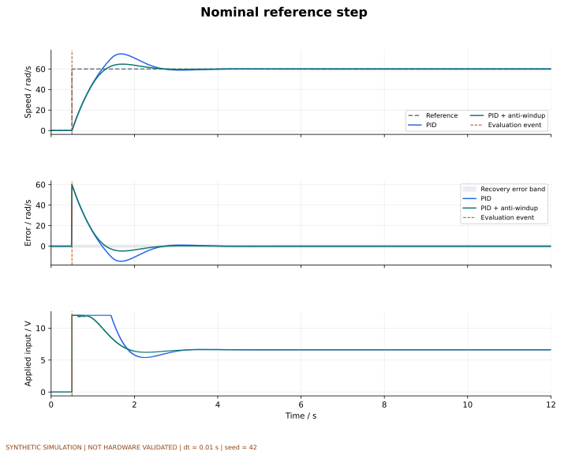
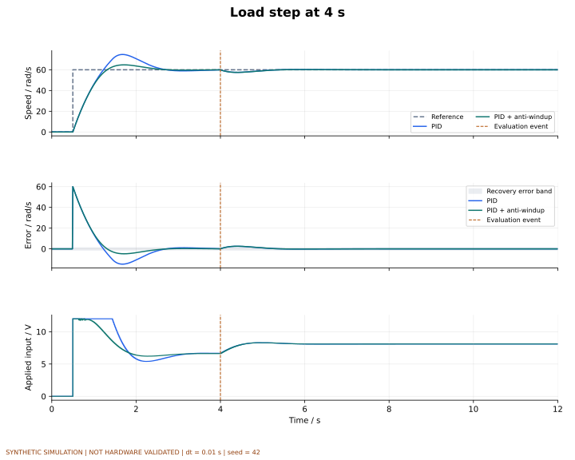
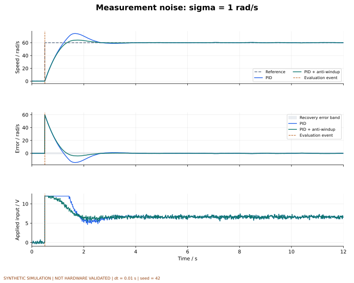
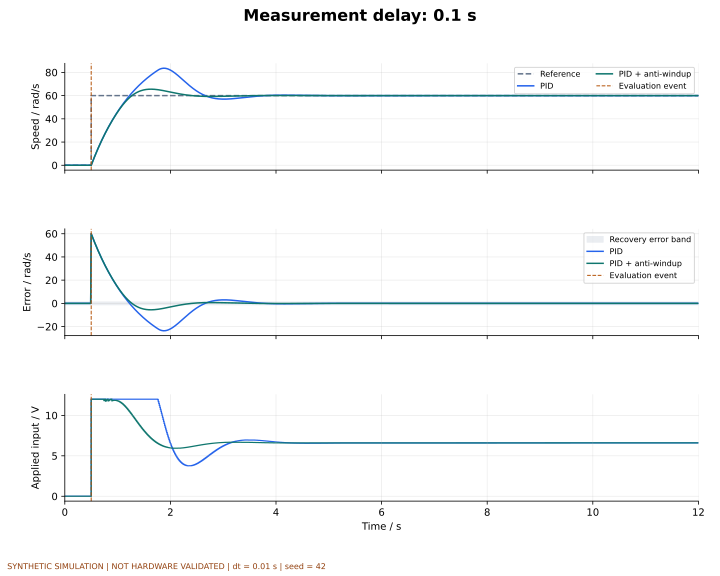
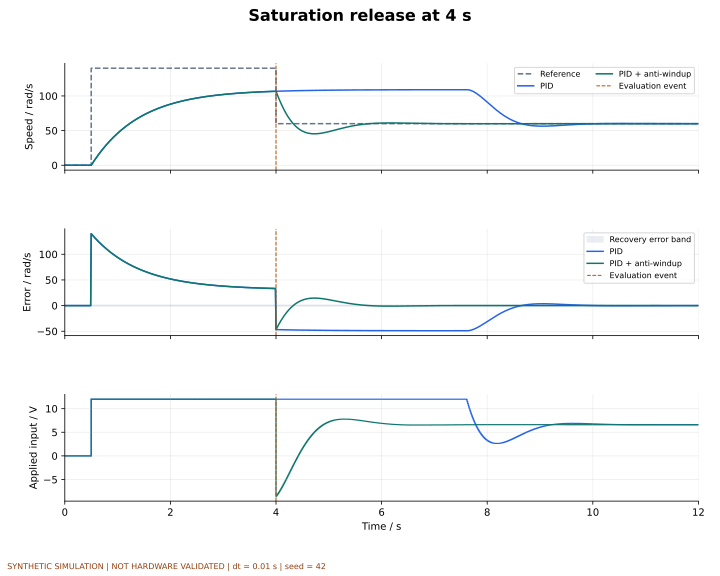
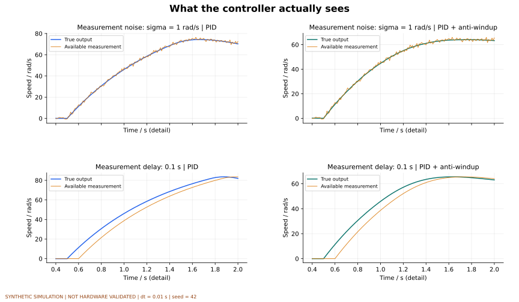
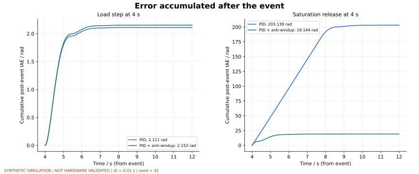
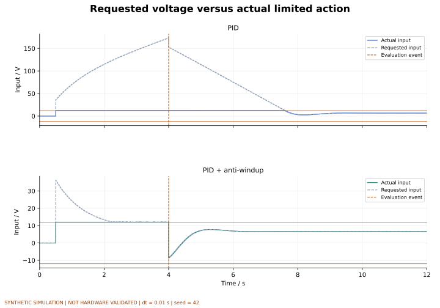

# 图表集

全部图表来自同一套合成电机仿真，未经硬件验证。每张提供PNG与SVG。

图表配置、指标、轨迹指纹和图片校验值见 [gallery.json](gallery.json)。

## Nominal reference step

正常参考阶跃：比较起步跟踪误差、误差带和限幅后的实际输入。

[PNG](nominal.png) · [SVG](nominal.svg)

## Load step at 4 s

4秒加入0.15 N m负载。全程图保留起步过程，事件后指标另行比较。

[PNG](load_step.png) · [SVG](load_step.svg)

## Measurement noise: sigma = 1 rad/s

两控制器使用同一噪声序列；电压抖动属于控制代价，不能把输入总变差当作能耗。

[PNG](measurement_noise.png) · [SVG](measurement_noise.svg)

## Measurement delay: 0.1 s

反馈延迟为0.1秒；控制器使用延迟测量，指标依据模型真实输出。

[PNG](measurement_delay.png) · [SVG](measurement_delay.svg)

## Saturation release at 4 s

4秒参考从140回落至60 rad/s；140超过该假设模型的可达稳态转速，用于观察积分饱和后果。

[PNG](saturation_release.png) · [SVG](saturation_release.svg)

## Different metrics reveal different trade-offs

五场景的事件后IAE、恢复时间、全评价窗口输入总变差和饱和比例。IAE面板使用对数轴；其余为线性轴。不同场景的事件含义不同，不把这些柱形合成总分。

[PNG](metric_overview.png) · [SVG](metric_overview.svg)

## What the controller actually sees

放大0.4至2秒的反馈过程，上行为噪声，下行为延迟；左右分别为两种控制器。橙线是控制器可见的测量，不是真实状态。

[PNG](feedback_detail.png) · [SVG](feedback_detail.svg)

## Error accumulated after the event

积分从4秒事件起点累计，末值与对应事件后IAE逐项核对。两面板分别使用自己的纵轴范围；不能凭曲线视觉高度跨面板比较。

[PNG](cumulative_error.png) · [SVG](cumulative_error.svg)

## Requested voltage versus actual limited action

饱和回落场景的请求输入与实际输入，上下分别为普通和抗饱和PID。实际输入保持在±12 V；不同纵轴范围避免掩盖请求值的差异。

[PNG](requested_vs_applied.png) · [SVG](requested_vs_applied.svg)
